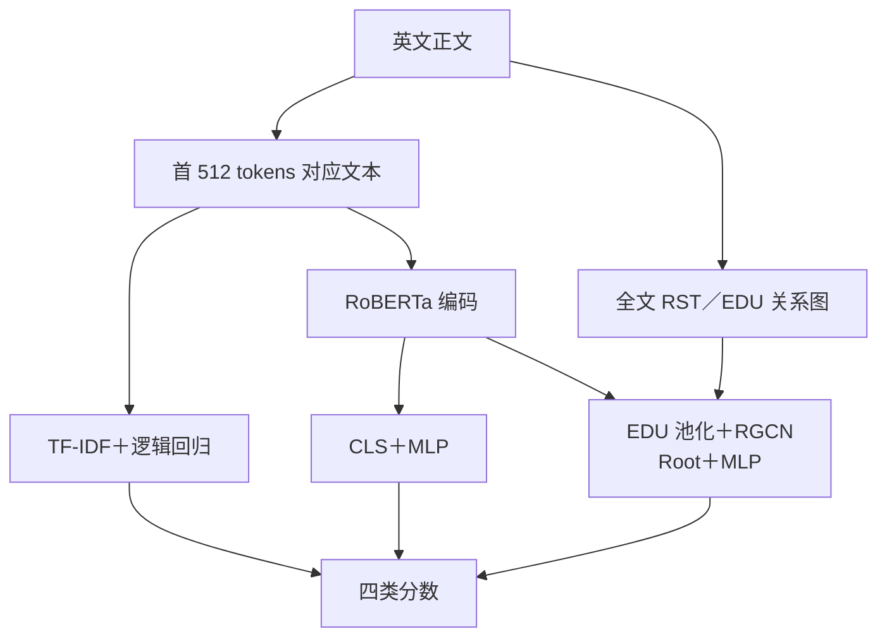

# EE6405 · 英文文本创作与编辑来源检测

比较 **TF-IDF＋逻辑回归、RoBERTa、RACE** 及关闭监督对比损失的消融，分析英文文本的创作与后续编辑来源。项目基于 [RACE](https://github.com/ICTMCG/RACE) 做课程复现与实验分析，新增固定分组划分、基线对照、多种子评估、解析审计和原始文本 Demo。

**当前状态：预定实验、结果分析和本机 Demo 已完成；正式 slides、真人视频和签名声明等提交材料待完成。** 详细清单见 [提交准备](docs/SUBMISSION.md)。GitHub 保存代码和评估证据，课程平台提交另行完成。

## 任务与数据

| 标签 | 数据集中的操作定义 |
|---|---|
| `human_written` | 人工原文 |
| `human_ai_polished` | 人工内容经 AI 润色 |
| `ai_generated` | AI 内容，包括发布版本中的 AI 到 AI 改写链 |
| `ai_humanized` | AI 内容经人工或工具改写；不等于已确认真人编辑 |

主实验使用 **HART**：清理后 15,984 条，按同源文本及重复关联分组隔离，训练／验证／测试为 **11,190／1,600／3,194**。其 arxiv、essay、news、writing 是同一基准的四个子域。

独立辅助评估使用 **HC3** 的 1,000 条人类／ChatGPT 回答。HC3 只有二分类真值，不能用于验证创作者／编辑者四分类泛化。数据版本、获取位置和运行前提见 [数据与外部资源](data/README.md)。

### 方法概览



各模型独立训练；RoBERTa 与 RACE 使用相同基础初始化。HART 使用作者发布的 RST 树，Demo／HC3 使用本机解析器。关闭 SupCon 的消融沿用 RACE 推理结构。

## 实验结果

固定 HART 分组测试集；神经模型按验证集 Macro-F1 选择 checkpoint。所有正式运行均有完整测试集重载复核记录。


*RoBERTa／RACE 展示三种子均值及样本标准差；TF-IDF 和关闭 SupCon 的消融各运行一次。*

| 方法 | 训练次数 | Macro-F1 | Macro-AUROC |
|---|---:|---:|---:|
| TF-IDF＋逻辑回归 | 1 | 79.40% | 96.24% |
| RoBERTa | 3 | **90.72% ± 0.25** | **98.89% ± 0.02** |
| RACE | 3 | 90.37% ± 0.60 | 98.67% ± 0.11 |
| RACE w/o SupCon | 1 | 88.89% | 98.36% |

均值与样本标准差来自种子 3407、42、2026；标准差单位为百分点。消融只运行一次。

- RACE 平均比 RoBERTa 低 0.35 个百分点，本组实验**不支持 RACE 总体更优**。
- 在种子 3407 上，完整 RACE 比关闭对比损失高 1.95 个百分点；尚未验证消融的多种子稳定性。
- HC3 上 RACE 的二分类 Macro-F1 为 38.69%，AI 召回率仅 8.40%，跨基准退化明显。模型分数未经校准，不能作为可靠作者身份鉴定。
- 词汇输入均为首 512 tokens，但 RACE 还保留全篇关系节点；模型容量也不同，因此两者差异不能全部归因为图结构。

完整图表、类别与子域指标、统计限制和计算成本见 [实验报告](experiments/reports/comparison/REPORT.md)。另有 [错误与互补案例](experiments/reports/comparison/CASE_STUDIES.md)、[HC3 分析](experiments/reports/auxiliary/REPORT.md) 和 [方法说明](experiments/METHOD_NOTES.md)。

## 快速查看与运行

### 仅克隆仓库：复核保存结果

在仓库根目录执行，使用 Python 3 标准库，无需 GPU、数据集或模型权重：

```bash
python3 scripts/check_results.py
```

脚本从逐条预测重新计算指标，核对八个正式运行、四组 HC3 结果及汇总表。它检验保存结果的内部一致性；重新加载 checkpoint 推理仍需要外部资源。

### 已配置的原实验主机：操作 Demo 和完整复核

<p align="center">
  
</p>

*RACE 原始文本交互界面。示例没有真实来源标签；图中耗时仅为该次请求记录，不是冷启动基准。*

```bash
# 原始英文输入 → 四类模型分数；RACE 使用真实 RST 解析器
bash experiments/run_demo.sh

# 重算分析图表，并检查数据、checkpoint、训练记录和重载证据
bash experiments/run_review.sh
```

Demo 地址为 <http://127.0.0.1:8765/>，默认 CPU。已有服务时直接打开地址。页面展示四类分数、输入截断、篇章树与耗时；无真实标签的自由输入仅用于功能演示。

**当前训练与推理脚本依赖原主机的 `/data/botao/ee6405-race-validation/`、两套 Python 环境，以及单独获取的官方源码。只克隆仓库不能直接启动 Demo。** 新机器从零安装尚未验证；所需目录、固定版本和获取步骤见 [数据与外部资源](data/README.md)，训练和重载命令见 [详细运行说明](experiments/README.md)。

## 仓库内容

```text
README.md                 项目概况、结果、运行入口
docs/                     课程原文、要求整理、提交清单
data/README.md            外部数据、权重与环境说明
experiments/              数据处理、训练、评估、RST 与 Demo
  configs/                冻结的实验配置
  reports/                正式指标、逐条预测、图表与审计记录
  METHOD_NOTES.md          实际模型与实验方法
  SOURCES.md               论文、代码、数据与版本来源
  VIDEO_OUTLINE.md         9 分 20 秒真人讲解提纲
scripts/check_results.py   无额外依赖的结果一致性复核
```

原始数据、模型权重、Python 环境、官方源码副本和一般运行日志不进入 Git。历史 smoke、旧版辅助输出和含正文的错误清单保留在原工作区，相关分析可在完整环境中重生成。提交的逐条预测保存 ID、标签和模型分数，不包含原始文章正文。

## 提交前待完成

- 制作理论／结果 slides，按 [讲解提纲](experiments/VIDEO_OUTLINE.md) 录制不超过 10 分钟的真人视频。
- 整理小组反思、真实成员贡献及全员签名，填写课程正式 GAI declaration 模板。
- 按课程平台要求整理代码附件；确认模型资源的交接方式和实际演示环境。
- 每位成员完成个人互评，并由小组完成课程平台上传与回执核查。

以上事项的状态与验收方式见 [提交准备](docs/SUBMISSION.md)。课程原文和评分标准见 [课程要求](docs/course-requirements.md)，第三方来源与使用边界见 [SOURCES](experiments/SOURCES.md)。
