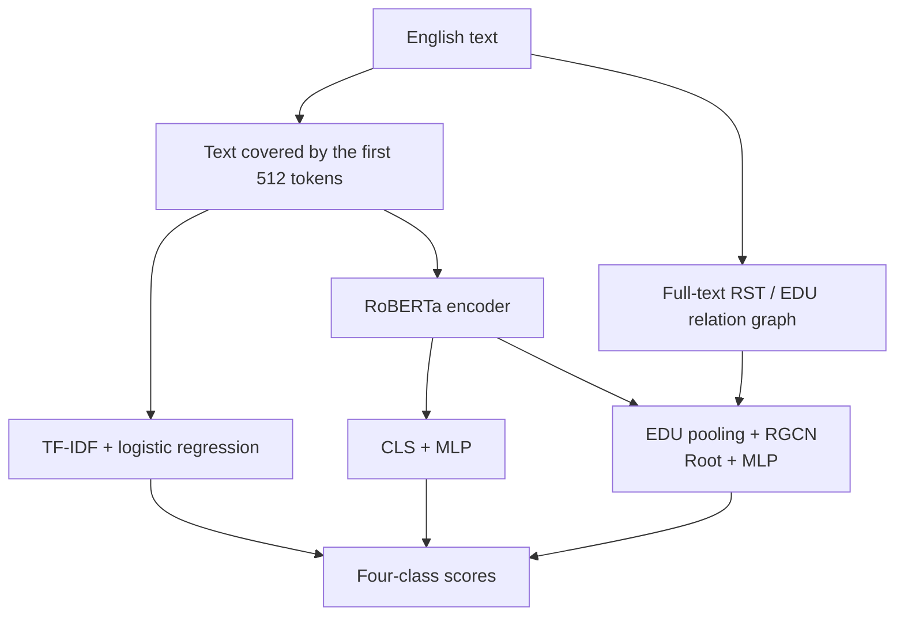
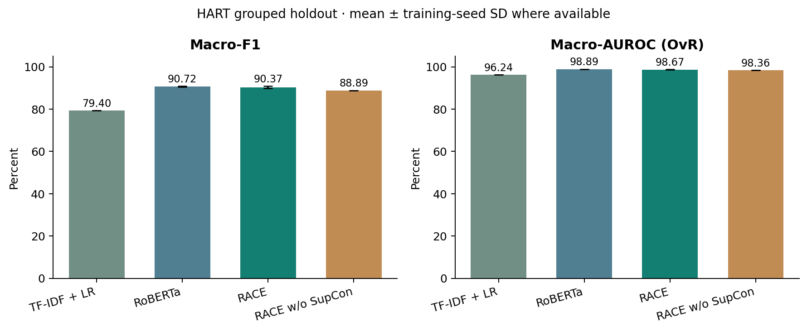
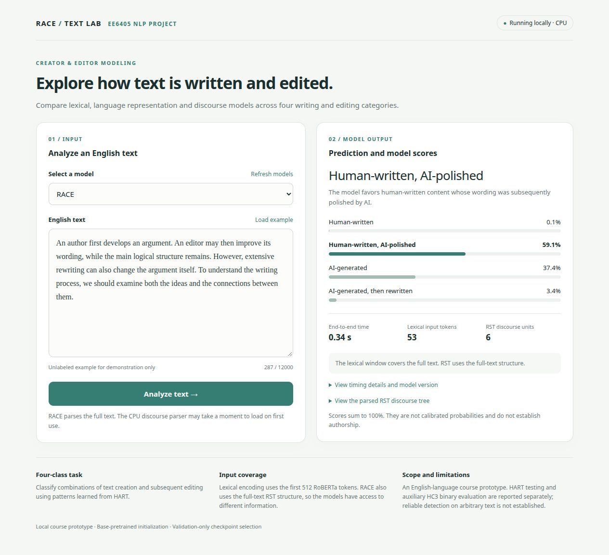

# EE6405 · Text Creation and Editing Detection

A course reproduction and analysis of [RACE](https://github.com/ICTMCG/RACE), comparing **TF-IDF + logistic regression, RoBERTa, RACE**, and a RACE ablation without supervised contrastive loss. The project adds a fixed grouped split, baseline comparisons, multiple training seeds, parser audits and an interactive raw-text demo.

**Status:** the planned experiments, analysis and local demo are complete. Final slides, a video with human narration and signed submission documents remain to be completed. See the [submission checklist](docs/SUBMISSION.md). This repository contains code and evaluation evidence; submission to the course platform is a separate step.

## Task and data

| Label | Operational definition in the released dataset |
|---|---|
| `human_written` | Human-written text |
| `human_ai_polished` | Human-written content polished by AI |
| `ai_generated` | AI-created content, including AI-to-AI rewriting chains |
| `ai_humanized` | AI-created content rewritten by a person or a tool; this does not confirm human editing |

The main benchmark is **HART**: 15,984 records after cleaning, with source-related and duplicate-linked texts kept in the same partition. The train / validation / test sizes are **11,190 / 1,600 / 3,194**. The arxiv, essay, news and writing subsets are domains within this benchmark.

An independent auxiliary evaluation uses 1,000 human / ChatGPT answers from **HC3**. HC3 provides binary labels only and cannot validate generalization of the four creation-and-editing classes. See [data and external resources](data/README.md) for versions, sources and runtime requirements.

### Method overview



Models are trained independently. RoBERTa and RACE use the same base-pretrained initialization. HART uses the released RST trees; the demo and HC3 use the local parser. The no-SupCon ablation retains the RACE inference architecture.

## Results

Results use the fixed HART grouped test set. Neural checkpoints are selected by validation Macro-F1. Every formal run has a complete test-set reload verification record.



*RoBERTa and RACE show the mean and sample standard deviation across three seeds. TF-IDF and the no-SupCon ablation each have one run.*

| Method | Runs | Macro-F1 | Macro-AUROC |
|---|---:|---:|---:|
| TF-IDF + logistic regression | 1 | 79.40% | 96.24% |
| RoBERTa | 3 | **90.72% ± 0.25** | **98.89% ± 0.02** |
| RACE | 3 | 90.37% ± 0.60 | 98.67% ± 0.11 |
| RACE w/o SupCon | 1 | 88.89% | 98.36% |

Means and sample standard deviations use seeds 3407, 42 and 2026. Standard deviations are in percentage points. The ablation has only one seed.

- RACE's mean Macro-F1 is 0.35 percentage points below RoBERTa. These experiments **do not support an overall advantage for RACE**.
- For seed 3407, full RACE exceeds the no-SupCon ablation by 1.95 percentage points. This ablation difference has not been checked across multiple seeds.
- On HC3, RACE reaches 38.69% binary Macro-F1 and only 8.40% AI recall, showing substantial cross-benchmark degradation. Scores are uncalibrated and cannot establish authorship.
- All models use the first 512 tokens for lexical input, but RACE also retains full-document relation nodes. Model capacities differ as well, so any difference cannot be attributed solely to graph structure.

See the [experimental report](experiments/reports/comparison/REPORT.md) for class and domain results, statistical limitations and computational costs. Additional material includes [error and complementary cases](experiments/reports/comparison/CASE_STUDIES.md), [HC3 analysis](experiments/reports/auxiliary/REPORT.md) and [method notes](experiments/METHOD_NOTES.md).

## Quick start

### Check saved results after cloning

Run from the repository root with the Python 3 standard library. No GPU, dataset or model weights are needed:

```bash
python3 scripts/check_results.py
```

The script recomputes metrics from individual predictions and checks eight formal runs, four HC3 evaluations and the aggregate tables. It checks internal consistency of the saved evidence; checkpoint inference still requires external resources.

### Use the demo on the configured experiment host

<p align="center">
  
</p>

*The interface and demonstration materials are in English. The example has no ground-truth authorship label. The displayed request time is an individual measurement, not a cold-start benchmark.*

```bash
# Raw English input -> four-class scores; RACE uses the actual RST parser
bash experiments/run_demo.sh

# Rebuild analysis plots and check data, checkpoints, training and reload evidence
bash experiments/run_review.sh
```

Open <http://127.0.0.1:8765/>. The demo uses the CPU by default and displays scores, input truncation, the parsed discourse tree and timing. Free-form input without a ground-truth label demonstrates functionality only.

**Training and inference currently depend on the original host's `/data/botao/ee6405-race-validation/` directory, two Python environments and separately obtained official source code. Cloning this repository alone is not sufficient to launch the demo.** A fresh-machine installation has not been verified. See [external resources](data/README.md) for directories, pinned versions and acquisition steps, and [run instructions](experiments/README.md) for training and reload commands.

## Repository contents

```text
README.md                 Project overview, results and entry points
docs/                     Original course documents and submission checklist
data/README.md            External data, weights and environment requirements
experiments/              Data preparation, training, evaluation, RST and demo
  configs/                Frozen experiment configurations
  reports/                Formal metrics, predictions, plots and audit records
  METHOD_NOTES.md          Implemented models and experimental methods
  SOURCES.md               Papers, code, data and version references
  VIDEO_OUTLINE.md         9-minute-20-second human presentation outline
scripts/check_results.py   Dependency-free saved-result consistency check
```

Raw datasets, model weights, Python environments, official source copies and routine logs are excluded from Git. Historical smoke runs, superseded auxiliary outputs and error lists containing full text remain in the original workspace. Submitted prediction tables contain IDs, labels and scores, without the source articles. Video renders and their editable local project remain outside Git to keep the repository small.

## Before submission

- Prepare theory and results slides, and record a video of no more than 10 minutes with human narration, following the [presentation outline](experiments/VIDEO_OUTLINE.md).
- Complete the group reflection, actual member contributions, all required signatures and the official GAI declaration template.
- Package the code as required by the course platform and confirm how model resources and the demonstration environment will be provided.
- Each member must complete the individual peer evaluation. The group must upload the final materials and verify the submission receipt.

See the [submission checklist](docs/SUBMISSION.md) for status and acceptance criteria, the [course requirements](docs/course-requirements.md) for the brief and rubric, and [SOURCES](experiments/SOURCES.md) for third-party provenance and usage boundaries.
