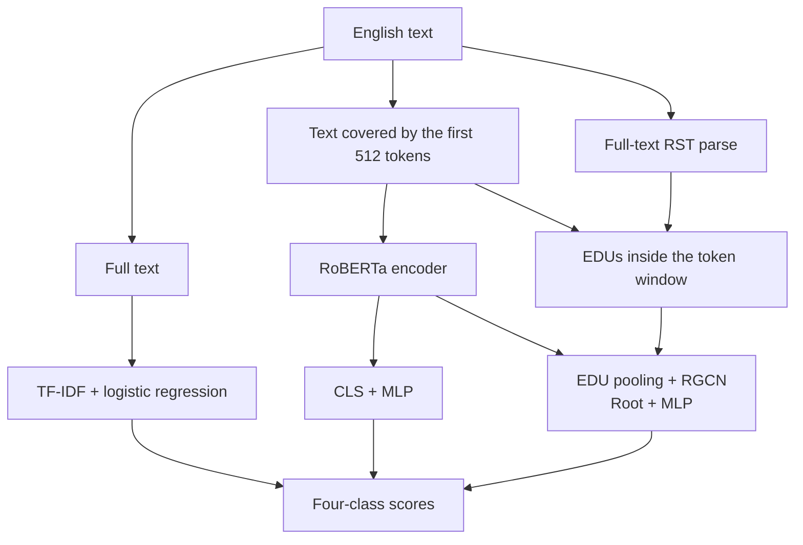
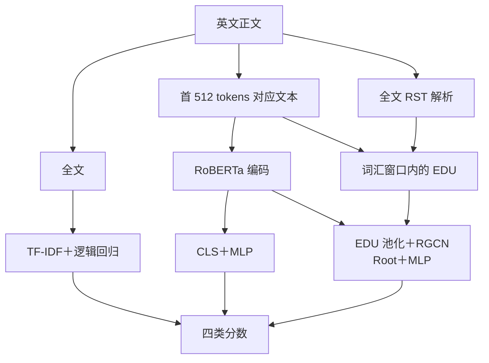

# EE6405 · Text Creation and Editing Detection

[English](#english) · [简体中文](#简体中文)

**[视频和讲稿 · Video and script](https://github.com/Realsbt/ee6405-nlp-project/releases/tag/untagged-cc115752d2bea3b46070)**

登录具有仓库写权限的 GitHub 账号，在 Release 草稿的 **Assets** 下载 9 分 20 秒无声视频与完整讲稿。

Download the 9:20 silent video and the full script under **Assets** in the draft release. Sign in with an account that has repository write access.

## English

A course reproduction and analysis of [RACE](https://github.com/ICTMCG/RACE), comparing **TF-IDF + logistic regression, RoBERTa, RACE**, with an architecture × objective 2×2 ablation (CE versus CE + supervised contrastive loss). The project adds a fixed grouped split, baseline comparisons, multiple training seeds, parser audits and an interactive raw-text demo.

**Experiment status (2026-11-06): the [2×2 ablation](docs/ABLATION_2X2.md) is complete.** Four neural conditions have three seeds each: **12 neural runs plus one TF-IDF baseline**. All five added runs, full test-set checkpoint verification, paired analyses and figures are complete. The four-method HC3 auxiliary evaluation and raw-text demo have been verified. Course deliverables and platform submission status are tracked separately in the [submission checklist](docs/SUBMISSION.md).

### Text Lab demo

Paste an English document and choose TF-IDF + logistic regression, RoBERTa, RACE, or RACE without SupCon. Text Lab runs locally and displays a score for each of the four classes.

<p align="center">
  
</p>

*RACE running the demo's unlabeled example with the model already loaded.*

**Try it without installing anything:** the [static Text Lab demo](https://realsbt.github.io/ee6405-nlp-project/) runs the real interface in the browser. **TF-IDF scores any text you paste**, computed locally from the exported weights and bit-identical to the server. RoBERTa and RACE replay frozen outputs for the built-in example, because a 500 MB transformer cannot run in a page.

- In **Explore & Edit**, use **Map** to jump between paragraphs and check explanation progress, and **Passages** to run a separate prediction on an excerpt. **Coverage** shows the lexical input window. TF-IDF reads the full input, and RoBERTa and RACE use up to 512 tokens for lexical input.
- In **Explain Prediction**, expand branches of the RACE discourse graph and request **Influence** for a selected unit or the visible units. The detail panel shows how suppressing a unit's features changes all four scores. Follow-up explanations can reuse preparation for the same text and model.
- With **What-if editing**, revise the text and choose **Reanalyze revised document** to run the same model again. Text Lab keeps the **Original** result and shows it alongside **Revised**, with the changed text and all four scores.
- **Compare models** runs independent predictions on the same text. **Export** saves a JSON report and includes the source text only if selected.

<details>
  <summary>See the score comparison after editing the example</summary>
  <p align="center">
    
  </p>
</details>

[Run Text Lab locally](#run-text-lab-on-linux-or-windows-wsl2) · [How the influence measurements work](docs/DOCUMENT_EXPLANATION.md)

### Task and data

| Label | Operational definition in the released dataset |
|---|---|
| `human_written` | Human-written text |
| `human_ai_polished` | Human-written content polished by AI |
| `ai_generated` | AI-created content, including AI-to-AI rewriting chains |
| `ai_humanized` | AI-created content rewritten by a person or a tool; this does not confirm human editing |

The main benchmark is **HART**: 15,984 records after cleaning, with source-related and duplicate-linked texts kept in the same partition. The train / validation / test sizes are **11,190 / 1,600 / 3,194**. The arxiv, essay, news and writing subsets are domains within this benchmark.

An independent auxiliary evaluation uses 1,000 human / ChatGPT answers from **HC3**. HC3 provides binary labels only and cannot validate generalization of the four creation-and-editing classes. See [data and external resources](data/README.md) for versions, sources and runtime requirements.

#### Experiment pipeline



Models are trained independently. RoBERTa and RACE use the same base-pretrained initialization. HART uses the released RST trees; the demo and HC3 use the local parser. Each neural architecture is trained both with and without SupCon; changing the objective leaves its inference architecture intact.

The RST parse covers the whole document, but the graph only contains EDUs that fall inside the 512-token lexical window, because EDU features come from the encoder. On a 9,000-character document the parser returns 179 EDUs and the graph keeps the 57 that the encoder can see; the rest are reported as outside the lexical window rather than silently dropped.

### Results

Results use the fixed HART grouped test set. Neural checkpoints are selected by validation Macro-F1. All twelve neural runs have complete test-set reload verification; the deterministic TF-IDF baseline is retained.


| Method | Runs | Macro-F1 | Macro-AUROC |
|---|---:|---:|---:|
| TF-IDF + logistic regression | 1 | 79.40% | 96.24% |
| RoBERTa · CE | 3 | 90.72% ± 0.25 | 98.89% ± 0.02 |
| RoBERTa · CE + SupCon | 3 | 91.15% ± 0.24 | 98.90% ± 0.06 |
| RACE · CE | 3 | 89.92% ± 0.90 | 98.34% ± 0.11 |
| RACE · CE + SupCon | 3 | 90.37% ± 0.60 | 98.67% ± 0.11 |

Neural results use seeds 3407, 42 and 2026. Values are means ± sample SD; SD is in percentage points. Each cell of the architecture × objective matrix has three runs.

- SupCon changes Macro-F1 by **+0.44 percentage points in RoBERTa** and **+0.45 in RACE**, using matched-seed mean differences.
- RACE − RoBERTa is **-0.80 points under CE** and **-0.78 under CE + SupCon**. The interaction (RACE's loss effect minus RoBERTa's) is **+0.01 points**. Per-seed differences and their SDs are in the report.
- Architecture comparisons also include pooling, representation dimension, parameter count and full-document structural information; they do not isolate graph structure alone.
- The five added runs extend an analysis whose original test results were already inspected. Three training seeds on the same split are not a new independent test or evidence of broad generalization.
- HC3 remains the original single-seed binary auxiliary comparison: full RACE has 38.69% Macro-F1 and 8.40% AI recall. This 2×2 extension concerns HART and does not establish an analogous HC3 improvement.


See the [experimental report](experiments/reports/comparison/REPORT.md), [2×2 protocol and commands](docs/ABLATION_2X2.md), [error cases](experiments/reports/comparison/CASE_STUDIES.md), [HC3 analysis](experiments/reports/auxiliary/REPORT.md) and [method notes](experiments/METHOD_NOTES.md).

### Quick start

#### Check saved results after cloning

Run from the repository root with the Python 3 standard library. No GPU, dataset or model weights are needed:

```bash
python3 scripts/check_results.py
```

The script recomputes metrics from individual predictions and checks thirteen formal runs, four HC3 evaluations, aggregate tables and five paired factorial contrasts. It checks internal consistency of the saved evidence; checkpoint inference still requires external resources.

#### Run Text Lab on Linux or Windows WSL2

```bash
# First install Python 3.11, Git, GitHub CLI and a C/C++ compiler.
# Run gh auth login before downloading the release assets.
export EE6405_STORAGE="$HOME/ee6405-resources"
python3 scripts/setup_environment.py --python python3.11 --torch cpu
export EE6405_PYTHON="$EE6405_STORAGE/.venv/bin/python"

"$EE6405_PYTHON" scripts/fetch_resources.py --profile demo
"$EE6405_PYTHON" scripts/check_installation.py --predict
bash experiments/run_demo.sh
```

Open <http://127.0.0.1:8765/> after the server starts. Text Lab uses the CPU by default.

The [resources-v1 release](https://github.com/Realsbt/ee6405-nlp-project/releases/tag/resources-v1) contains the TF-IDF classifier and all 12 neural checkpoints. Use `scripts/fetch_resources.py --profile full` to download the weights and data needed for checkpoint replay.

The demo profile downloads about **4.28 GiB** of resources plus its Python environment. Upstream resources come from pinned original sources. A relocated Linux checkout and a fresh isolated CPU environment have passed all four demo models, exact dataset reconstruction and preprocessing checks. WSL2 instructions are provided but were not exercised in this check.

Follow the **[Linux / WSL2 reproduction guide](docs/REPRODUCING.md)** for prerequisites, full-data restoration, hardware requirements and GPU training. The original `/data/botao/ee6405-race-validation/` directory remains a local resource store; teammates choose their own `EE6405_STORAGE`. Historical result paths are resolved at read time without changing their provenance.

### Repository contents

```text
README.md                 Project overview in English and Simplified Chinese
docs/                     Original course documents and submission checklist
data/README.md            External data, weights and environment requirements
experiments/              Data preparation, training, evaluation, RST and demo
  configs/                Frozen experiment configurations
  reports/                Formal metrics, predictions, plots and audit records
  METHOD_NOTES.md          Implemented models and experimental methods
  SOURCES.md               Papers, code, data and version references
  VIDEO_OUTLINE.md         9-minute-20-second human presentation outline
scripts/check_results.py   Dependency-free saved-result consistency check
scripts/                  Environment setup, resource download and validation
resources/                Pinned resource manifest and frozen HC3 selection
```

Raw datasets, model weights, Python environments, official source copies and routine logs are excluded from Git. Historical smoke runs, superseded auxiliary outputs and error lists containing full text remain in the original workspace. Submitted prediction tables contain IDs, labels and scores, without the source articles. Video renders and their editable local project remain outside Git to keep the repository small.

### Before submission

- Prepare theory and results slides, and record a video of no more than 10 minutes with human narration, following the [presentation outline](experiments/VIDEO_OUTLINE.md).
- Complete the group reflection, actual member contributions, all required signatures and the official GAI declaration template.
- Package the code as required by the course platform and confirm how model resources and the demonstration environment will be provided.
- Each member must complete the individual peer evaluation. The group must upload the final materials and verify the submission receipt.

See the [submission checklist](docs/SUBMISSION.md) for status and acceptance criteria, the [course requirements](docs/course-requirements.md) for the brief and rubric, and [SOURCES](experiments/SOURCES.md) for third-party provenance and usage boundaries.

---

## 简体中文

**英文文本创作与编辑来源检测**

比较 **TF-IDF＋逻辑回归、RoBERTa、RACE**，并以 CE／CE＋SupCon 构成架构 × 损失的 2×2 消融，分析英文文本的创作与后续编辑来源。项目基于 [RACE](https://github.com/ICTMCG/RACE) 做课程复现与实验分析，新增固定分组划分、基线对照、多种子评估、解析审计和原始文本 Demo。

**实验状态（2026-11-06）：[2×2 消融](docs/ABLATION_2X2.md) 已全部完成。** 四种神经配置各三个种子，共 **12 次神经训练＋1 次 TF-IDF 基线**；新增五次训练、完整测试集重载复核、配对分析及图表均已完成。四方法 HC3 辅助评估和原始文本 Demo 已验证。课程提交材料与平台状态单独记录在 [提交准备](docs/SUBMISSION.md)。

### Text Lab 演示

Text Lab 是在本机运行的英文 Demo。粘贴英文文本后，选择 TF-IDF＋逻辑回归、RoBERTa、RACE 或无 SupCon 的 RACE，即可查看四类分数。

<p align="center">
  
</p>

*截图来自 RACE 模型载入后对内置无标签示例的实际预测。*

**不需安装即可体验：**[静态 Text Lab 演示](https://realsbt.github.io/ee6405-nlp-project/) 在浏览器中运行真实界面。**TF-IDF 可以对你粘贴的任意文本计算**，在本地用导出的权重推理，结果与服务端逐位一致。RoBERTa 和 RACE 回放内置示例的冻结输出，因为 500 MB 的 transformer 无法在页面里运行。

- 在 **Explore & Edit** 中，通过 **Map** 按段落跳转并查看解释进度，通过 **Passages** 对选定片段单独预测。**Coverage** 显示词汇输入范围。TF-IDF 读取全文，RoBERTa 和 RACE 的词汇输入最多为 512 个 token。
- 在 **Explain Prediction** 中，可以展开 RACE 篇章图的分支，对选定或可见的单元按需计算 **Influence**。详情面板显示抑制该单元特征后四类分数如何变化。同一文本和模型的后续解释请求可以复用预处理结果。
- 使用 **What-if editing** 修改原文，然后点击 **Reanalyze revised document**，用同一个模型重新预测。Text Lab 保留 **Original** 的结果，与 **Revised** 一起显示四类分数和文本改动。
- **Compare models** 对同一文本分别运行各模型。**Export** 可导出 JSON 报告，勾选后才会附上原文。

<details>
  <summary>查看修改示例后四类分数的对比</summary>
  <p align="center">
    
  </p>
</details>

[在本机运行 Text Lab](#在-linux-或-windows-wsl2-上运行-text-lab) · [单元影响的计算方法](docs/DOCUMENT_EXPLANATION.md)

### 任务与数据

| 标签 | 数据集中的操作定义 |
|---|---|
| `human_written` | 人工原文 |
| `human_ai_polished` | 人工内容经 AI 润色 |
| `ai_generated` | AI 内容，包括发布版本中的 AI 到 AI 改写链 |
| `ai_humanized` | AI 内容经人工或工具改写；不等于已确认真人编辑 |

主实验使用 **HART**：清理后 15,984 条，按同源文本及重复关联分组隔离，训练／验证／测试为 **11,190／1,600／3,194**。其 arxiv、essay、news、writing 是同一基准的四个子域。

独立辅助评估使用 **HC3** 的 1,000 条人类／ChatGPT 回答。HC3 只有二分类真值，不能用于验证创作者／编辑者四分类泛化。数据版本、获取位置和运行前提见 [数据与外部资源](data/README.md)。

#### 实验流程



各模型独立训练；RoBERTa 与 RACE 使用相同基础初始化。HART 使用作者发布的 RST 树，Demo／HC3 使用本机解析器。两种神经架构分别启用或关闭 SupCon；损失开关不改变各自推理结构。

RST 解析覆盖全文，但图中只保留落在 512 token 词汇窗口内的 EDU，因为 EDU 特征来自编码器。一篇 9,000 字符的文档解析出 179 个 EDU，图中保留编码器能看到的 57 个；其余标记为词汇窗口外，而不是静默丢弃。

### 实验结果

使用固定 HART 分组测试集，神经模型只按验证集 Macro-F1 选 checkpoint。十二次神经运行均完成完整测试集重载复核，保留原确定性 TF-IDF 基线。


| 方法 | 训练次数 | Macro-F1 | Macro-AUROC |
|---|---:|---:|---:|
| TF-IDF + logistic regression | 1 | 79.40% | 96.24% |
| RoBERTa · CE | 3 | 90.72% ± 0.25 | 98.89% ± 0.02 |
| RoBERTa · CE + SupCon | 3 | 91.15% ± 0.24 | 98.90% ± 0.06 |
| RACE · CE | 3 | 89.92% ± 0.90 | 98.34% ± 0.11 |
| RACE · CE + SupCon | 3 | 90.37% ± 0.60 | 98.67% ± 0.11 |

四个神经配置各使用种子 3407、42、2026；报告均值 ± 样本标准差，标准差单位为百分点。

- 同种子配对后，SupCon 对 RoBERTa 的平均 Macro-F1 增益为 **+0.44 个百分点**，对 RACE 为 **+0.45 个百分点**。
- 相同目标下，RACE−RoBERTa 的差异为：**CE 下 -0.80**、**CE＋SupCon 下 -0.78 个百分点**。交互项（RACE 的损失增益 − RoBERTa 的损失增益）为 **+0.01 个百分点**。逐种子差值及其 SD 见完整报告。
- 架构差异仍包含 pooling、表示维度、参数量和全篇结构信息，不能全部归因于篇章图。
- 本轮五次补跑在查看原有结果后确定，沿用同一保留测试集；三个训练种子不构成新增独立测试，也不能证明广泛泛化。
- HC3 仍是原单种子辅助二分类比较：完整 RACE 的 Macro-F1 为 38.69%、AI 召回为 8.40%。本轮 2×2 补跑针对 HART，不能据此推出 HC3 上也有相同收益。


完整结果见 [实验报告](experiments/reports/comparison/REPORT.md)；运行与证据边界见 [2×2 消融协议](docs/ABLATION_2X2.md)。另有 [错误案例](experiments/reports/comparison/CASE_STUDIES.md)、[HC3 分析](experiments/reports/auxiliary/REPORT.md) 和 [方法说明](experiments/METHOD_NOTES.md)。

### 快速查看与运行

#### 仅克隆仓库：复核保存结果

在仓库根目录执行，使用 Python 3 标准库，无需 GPU、数据集或模型权重：

```bash
python3 scripts/check_results.py
```

脚本从逐条预测重新计算指标，核对十三个正式运行、四组 HC3 结果、汇总表与五个配对消融差异。它检验保存结果的内部一致性；重新加载 checkpoint 推理仍需要外部资源。

#### 在 Linux 或 Windows WSL2 上运行 Text Lab

```bash
# 先安装 Python 3.11、Git、GitHub CLI、C/C++ 编译器。
# 下载 Release 资源前运行 gh auth login。
export EE6405_STORAGE="$HOME/ee6405-resources"
python3 scripts/setup_environment.py --python python3.11 --torch cpu
export EE6405_PYTHON="$EE6405_STORAGE/.venv/bin/python"

"$EE6405_PYTHON" scripts/fetch_resources.py --profile demo
"$EE6405_PYTHON" scripts/check_installation.py --predict
bash experiments/run_demo.sh
```

服务启动后，打开 <http://127.0.0.1:8765/>。Text Lab 默认在 CPU 上运行。

[resources-v1 Release](https://github.com/Realsbt/ee6405-nlp-project/releases/tag/resources-v1) 已提供 TF-IDF 分类器和全部 12 个神经模型权重。使用 `scripts/fetch_resources.py --profile full` 下载重跑测试推理所需的权重与数据。

Demo profile 下载约 **4.28 GiB** 资源，另加 Python 环境。上游资源从固定版本的原始来源获取。已经在迁移后的 Linux checkout 和新建独立 CPU 环境中跑通四个 Demo 模型，并完成固定数据重建和预处理检查。提供 WSL2 步骤，本次验证在 Linux 完成。

系统准备、完整数据恢复、硬件要求和 GPU 训练见 **[Linux / WSL2 复现指南](docs/REPRODUCING.zh-CN.md)**。原来的 `/data/botao/ee6405-race-validation/` 继续作为本机资源目录；组员自行设置 `EE6405_STORAGE`。历史结果中的路径在读取时映射，保留原始来源记录。

### 仓库内容

```text
README.md                 中英文项目概况、结果和运行入口
docs/                     课程原文、要求整理、提交清单
data/README.md            外部数据、权重与环境说明
experiments/              数据处理、训练、评估、RST 与 Demo
  configs/                冻结的实验配置
  reports/                正式指标、逐条预测、图表与审计记录
  METHOD_NOTES.md          实际模型与实验方法
  SOURCES.md               论文、代码、数据与版本来源
  VIDEO_OUTLINE.md         9 分 20 秒真人讲解提纲
scripts/check_results.py   无额外依赖的结果一致性复核
scripts/                  环境安装、资源下载与校验入口
resources/                固定资源清单和 HC3 原始选择记录
```

原始数据、模型权重、Python 环境、官方源码副本和一般运行日志不进入 Git。历史 smoke、旧版辅助输出和含正文的错误清单保留在原工作区，相关分析可在完整环境中重生成。提交的逐条预测保存 ID、标签和模型分数，不包含原始文章正文。视频成品及其可编辑工程保留在本地，不进入 Git，以保持仓库简洁。

### 提交前待完成

- 制作理论／结果 slides，按 [讲解提纲](experiments/VIDEO_OUTLINE.md) 录制不超过 10 分钟的真人视频。
- 整理小组反思、真实成员贡献及全员签名，填写课程正式 GAI declaration 模板。
- 按课程平台要求整理代码附件；确认模型资源的交接方式和实际演示环境。
- 每位成员完成个人互评，并由小组完成课程平台上传与回执核查。

以上事项的状态与验收方式见 [提交准备](docs/SUBMISSION.md)。课程原文和评分标准见 [课程要求](docs/course-requirements.md)，第三方来源与使用边界见 [SOURCES](experiments/SOURCES.md)。
