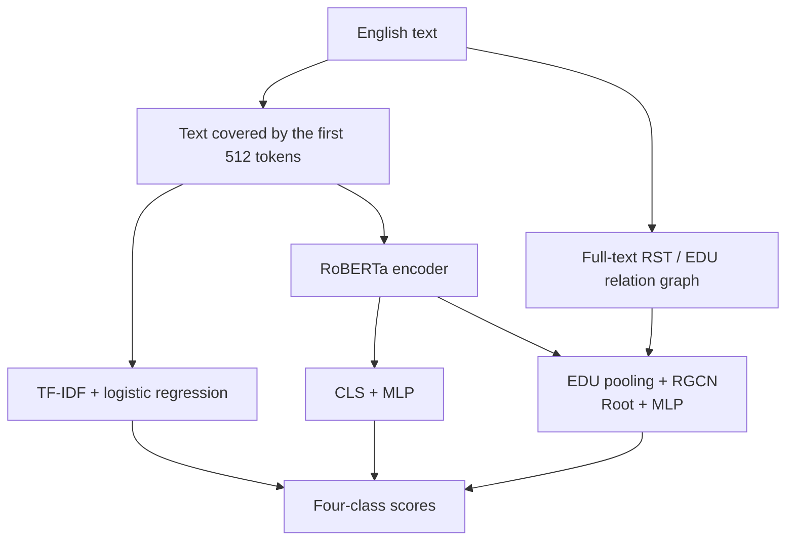

# EE6405 · Text Creation and Editing Detection

**English** | [简体中文](README.zh-CN.md)

A course reproduction and analysis of [RACE](https://github.com/ICTMCG/RACE), comparing **TF-IDF + logistic regression, RoBERTa, RACE**, with an architecture × objective 2×2 ablation (CE versus CE + supervised contrastive loss). The project adds a fixed grouped split, baseline comparisons, multiple training seeds, parser audits and an interactive raw-text demo.

**Experiment status (2026-11-06): the [2×2 ablation](docs/ABLATION_2X2.md) is complete.** Four neural conditions have three seeds each: **12 neural runs plus one TF-IDF baseline**. All five added runs, full test-set checkpoint verification, paired analyses and figures are complete. The four-method HC3 auxiliary evaluation and raw-text demo have been verified. Course deliverables and platform submission status are tracked separately in the [submission checklist](docs/SUBMISSION.md).

## Contributions and current status

**Snapshot: 2026-11-12, 13:22 Singapore (UTC+8).** These additions are separate
from the shared, completed 2x2 study above. Full ownership, evidence and remaining
work are recorded in [Yingqi's contribution/status report](docs/YINGQI_STATUS.md).

- **Method extension:** RoBERTa + residual Text-EDU fusion,
  `CLS + gate(CLS, EDU_context) * EDU_context`, with matched CLS / mean /
  attention / gated variants. This is Yingqi's added project module, not a
  claim to invent RoBERTa, CLS, EDU, attention or gating.
- **Controlled evaluation:** same-visible-window text / graph / shuffled-relation /
  EDU controls, audited parsing/cache, reproducible training and predictions.
- **Completed ensemble result:** CPU-fitted CE + RACE + TF-IDF stacking achieves
  **93.61% HART test Macro-F1**. This is a real single-seed, exploratory ensemble
  result, not the new fusion model's result or a three-seed mean.
- **Reliability analysis:** external transfer, low-FPR diagnostics and editing
  sensitivity; the stacking gain does not transfer to the frozen MixSet subset.

| Work | Compute and verified completion | Still incomplete |
|---|---|---|
| Same-window controls | Tesla T4: all 4 conditions, seed 3407, complete test predictions | Seeds 42 / 2026: 8 planned runs not completed |
| Text-EDU fusion | Tesla T4: 4 CUDA smokes; 4 seed-3407 screening trainings + CLS seed 42 complete | Three remaining confirmation runs and final three-seed test report |
| Fusion continuation | Kaggle API reports `RUNNING`; original job reports `CANCEL_ACKNOWLEDGED` | Not counted as completed; no verified final summary yet |
| Probability blend / stacking | Frozen neural checkpoints reused; CPU selection, meta-model fitting and evaluation complete | No new GPU encoder training for these analyses |
| Gate-strength controls / segmentation + consistency / calibration | Code, CPU checks and reporting/DFS runners included | Formal GPU results not completed; no gain claimed |

Fusion **validation** Macro-F1 at seed 3407 is CLS **90.6435%**, mean **90.8501%**,
attention **90.8956%**, gated **91.3643%**. Gated was selected on validation
(+0.7208 percentage points over matched CLS); this is not final test improvement.
The continuation preserves completed runs and reruns missing training from base
pretraining; it does not count interrupted partial training as a completed run.

Entry points: [fusion design and commands](docs/EDU_FUSION.md),
[reuse attribution](docs/REUSE_ATTRIBUTION.md),
[unfinished follow-up experiments](docs/FUSION_NEXT_STEPS.zh-CN.md),
[saved snapshot evidence](experiments/reports/yingqi_snapshot/).
Model weights, private source texts and credentials are not uploaded.

```bash
python3 scripts/check_yingqi_results.py
```

This dependency-free check recomputes the saved same-window/fusion/stacking
Macro-F1 values and checks evidence hashes. It does not rerun GPU inference.

### Fair-window mechanism controls

The original RoBERTa/RACE comparison changes the visible text range, pooling,
parameter count and graph processing at the same time. A new protocol therefore
reparses the **exact same visible 512-token prefix** and compares four CE-only
conditions from the same base-pretrained initialization:

| Condition | Controlled change | Parameters (total / trainable) |
|---|---|---:|
| `text` | RoBERTa CLS + MLP | 125,239,300 / 7,681,540 |
| `graph` | RACE on the same visible prefix | 128,617,148 / 11,059,388 |
| `shuffled` | Per-document relation assignments shuffled; topology and histogram preserved | 128,617,148 / 11,059,388 |
| `edu` | Equal-weight EDU pooling + matched-width head; no GNN | 125,305,092 / 7,747,332 |

The full cache covers **15,984 / 15,984 records** with train / validation /
test sizes **11,190 / 1,600 / 3,194**, zero failed or pending records, zero
cross-split exact visible-prefix duplicates and no EDU nodes outside the visible
prefix. The relation control changes **467,369 / 638,038 relation nodes
(73.25%)** and the same fraction of 2,552,152 directed edge types while
preserving topology. All four conditions passed CPU and Kaggle CUDA
forward/backward smoke checks with identical token fingerprints; the repository
tests cover the deterministic control and Unicode offset recovery. The CUDA
check used a Tesla T4 and measured peak allocated memory of 653.89 MiB for
`text`, 838.98 MiB for `graph`, 838.99 MiB for `shuffled` and 655.39 MiB for
`edu`. Gradients were finite, trainable layers changed, frozen embeddings did
not change and the test split was not evaluated.

The seed-3407 formal GPU run is now complete, with all 3,194 test predictions
per condition downloaded and metrics independently recomputed:

| Same-window condition | Validation Macro-F1 | Test Macro-F1 |
|---|---:|---:|
| `text` | 91.38% | **91.28%** |
| `graph` | 89.32% | 89.69% |
| `shuffled` | 89.33% | 90.07% |
| `edu` | 90.91% | 90.89% |

At this seed, text is strongest and the original relation assignment does not
beat the shuffled control. The 4 conditions × 3 seeds matrix remains incomplete:
this does not establish a stable multi-seed ranking or that graphs are generally
useless. [Raw results and predictions](experiments/reports/same_window/seed_3407/)
are included. Commands, hashes and acceptance criteria are in the
[same-window protocol](docs/SAME_WINDOW_ABLATION.md).

The individual contribution package also includes
[six presentation-ready figures](experiments/reports/same_window/figures/),
the [source data for every new chart](experiments/reports/same_window/figure_data.csv)
and a reproducible data manifest. The full problem-method-result-limitations record is in the
[Yingqi contribution report](experiments/reports/same_window/REPORT.md).

Exploratory reuse of existing checkpoints found that the HART gains did not
transfer to the frozen 359-text MixSet subset:

| Existing model or analysis | HART Macro-F1 | MixSet subset Macro-F1 |
|---|---:|---:|
| RoBERTa CE, seed 3407 | 90.75% | 39.01% |
| RACE CE + SupCon, seed 3407 | 90.84% | 33.38% |
| CE/RACE probability blend | 92.10% | 36.86% |
| CE + RACE + TF-IDF stacking | 93.61% | 36.22% |
| Length + lightweight structure LR | 52.67% | 29.16% |

MixSet here is a conservative 359-text / 91-source-group subset, not the full
official benchmark. Stacking uses one underlying neural seed and the original
HART test set had already been inspected, so these numbers are diagnostic rather
than independent confirmation or a state-of-the-art claim.

## Task and data

| Label | Operational definition in the released dataset |
|---|---|
| `human_written` | Human-written text |
| `human_ai_polished` | Human-written content polished by AI |
| `ai_generated` | AI-created content, including AI-to-AI rewriting chains |
| `ai_humanized` | AI-created content rewritten by a person or a tool; this does not confirm human editing |

The main benchmark is **HART**: 15,984 records after cleaning, with source-related and duplicate-linked texts kept in the same partition. The train / validation / test sizes are **11,190 / 1,600 / 3,194**. The arxiv, essay, news and writing subsets are domains within this benchmark.

An independent auxiliary evaluation uses 1,000 human / ChatGPT answers from **HC3**. HC3 provides binary labels only and cannot validate generalization of the four creation-and-editing classes. See [data and external resources](data/README.md) for versions, sources and runtime requirements.

### Method overview



Models are trained independently. RoBERTa and RACE use the same base-pretrained initialization. HART uses the released RST trees; the demo and HC3 use the local parser. Each neural architecture is trained both with and without SupCon; changing the objective leaves its inference architecture intact.

## Results

Results use the fixed HART grouped test set. Neural checkpoints are selected by validation Macro-F1. All twelve neural runs have complete test-set reload verification; the deterministic TF-IDF baseline is retained.


| Method | Runs | Macro-F1 | Macro-AUROC |
|---|---:|---:|---:|
| TF-IDF + logistic regression | 1 | 79.40% | 96.24% |
| RoBERTa · CE | 3 | 90.72% ± 0.25 | 98.89% ± 0.02 |
| RoBERTa · CE + SupCon | 3 | 91.15% ± 0.24 | 98.90% ± 0.06 |
| RACE · CE | 3 | 89.92% ± 0.90 | 98.34% ± 0.11 |
| RACE · CE + SupCon | 3 | 90.37% ± 0.60 | 98.67% ± 0.11 |

Neural results use seeds 3407, 42 and 2026. Values are means ± sample SD; SD is in percentage points. Each cell of the architecture × objective matrix has three runs.

- SupCon changes Macro-F1 by **+0.44 percentage points in RoBERTa** and **+0.45 in RACE**, using matched-seed mean differences.
- RACE − RoBERTa is **-0.80 points under CE** and **-0.78 under CE + SupCon**. The interaction (RACE's loss effect minus RoBERTa's) is **+0.01 points**. Per-seed differences and their SDs are in the report.
- Architecture comparisons also include pooling, representation dimension, parameter count and full-document structural information; they do not isolate graph structure alone.
- The five added runs extend an analysis whose original test results were already inspected. Three training seeds on the same split are not a new independent test or evidence of broad generalization.
- HC3 remains the original single-seed binary auxiliary comparison: full RACE has 38.69% Macro-F1 and 8.40% AI recall. This 2×2 extension concerns HART and does not establish an analogous HC3 improvement.


See the [experimental report](experiments/reports/comparison/REPORT.md), [2×2 protocol and commands](docs/ABLATION_2X2.md), [error cases](experiments/reports/comparison/CASE_STUDIES.md), [HC3 analysis](experiments/reports/auxiliary/REPORT.md) and [method notes](experiments/METHOD_NOTES.md).

## Quick start

### Check saved results after cloning

Run from the repository root with the Python 3 standard library. No GPU, dataset or model weights are needed:

```bash
python3 scripts/check_results.py
```

The script recomputes metrics from individual predictions and checks thirteen formal runs, four HC3 evaluations, aggregate tables and five paired factorial contrasts. It checks internal consistency of the saved evidence; checkpoint inference still requires external resources.

### Run the English demo on Linux / Windows WSL2

<p align="center">
  
</p>

*The interface and demonstration materials are in English. The example has no ground-truth authorship label. The displayed request time is an individual measurement, not a cold-start benchmark.*

```bash
# First install Python 3.11, Git, GitHub CLI and a C/C++ compiler.
# Each teammate needs access to this private repository and gh auth login.
export EE6405_STORAGE="$HOME/ee6405-resources"
python3 scripts/setup_environment.py --python python3.11 --torch cpu
export EE6405_PYTHON="$EE6405_STORAGE/.venv/bin/python"

"$EE6405_PYTHON" scripts/fetch_resources.py --profile demo
"$EE6405_PYTHON" scripts/check_installation.py --predict
bash experiments/run_demo.sh
```

Open <http://127.0.0.1:8765/>. The demo uses the CPU by default and displays scores, input truncation, the parsed discourse tree and timing. Free-form input without a ground-truth label demonstrates functionality only.

GitHub contains results for all 13 formal runs. The `resources-v1` release still provides the original eight models and excludes the five added checkpoints. The demo retains its original four methods; RoBERTa + SupCon is not a demo option.

The demo downloads about **4.28 GiB** of resources plus its Python environment. Our checkpoints are distributed through the private [resources-v1 release](https://github.com/Realsbt/ee6405-nlp-project/releases/tag/resources-v1); upstream resources are fetched from pinned original sources. They are not stored in Git. A relocated Linux checkout and a fresh isolated CPU environment have passed all four demo models, exact dataset reconstruction and preprocessing checks. WSL2 instructions are provided but were not exercised in this check.

Follow the **[Linux / WSL2 reproduction guide](docs/REPRODUCING.md)** for prerequisites, full-data restoration, hardware requirements and GPU training. The original `/data/botao/ee6405-race-validation/` directory remains a local resource store; teammates choose their own `EE6405_STORAGE`. Historical result paths are resolved at read time without changing their provenance.

## Repository contents

```text
README.md                 English project overview, results and entry points
README.zh-CN.md           Chinese version of the project overview
docs/                     Original course documents and submission checklist
data/README.md            External data, weights and environment requirements
experiments/              Data preparation, training, evaluation, RST and demo
  configs/                Frozen experiment configurations
  reports/                Formal metrics, predictions, plots and audit records
  METHOD_NOTES.md          Implemented models and experimental methods
  SOURCES.md               Papers, code, data and version references
  VIDEO_OUTLINE.md         9-minute-20-second human presentation outline
scripts/check_results.py   Dependency-free saved-result consistency check
scripts/                  Environment setup, resource download and validation
resources/                Pinned resource manifest and frozen HC3 selection
```

Raw datasets, model weights, Python environments, official source copies and routine logs are excluded from Git. Historical smoke runs, superseded auxiliary outputs and error lists containing full text remain in the original workspace. Submitted prediction tables contain IDs, labels and scores, without the source articles. Video renders and their editable local project remain outside Git to keep the repository small.

## Before submission

- Prepare theory and results slides, and record a video of no more than 10 minutes with human narration, following the [presentation outline](experiments/VIDEO_OUTLINE.md).
- Complete the group reflection, actual member contributions, all required signatures and the official GAI declaration template.
- Package the code as required by the course platform and confirm how model resources and the demonstration environment will be provided.
- Each member must complete the individual peer evaluation. The group must upload the final materials and verify the submission receipt.

See the [submission checklist](docs/SUBMISSION.md) for status and acceptance criteria, the [course requirements](docs/course-requirements.md) for the brief and rubric, and [SOURCES](experiments/SOURCES.md) for third-party provenance and usage boundaries.
