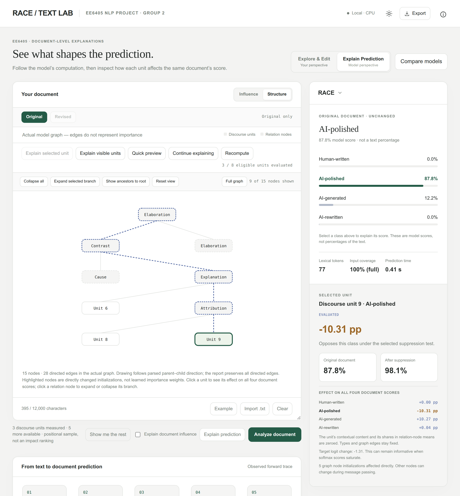
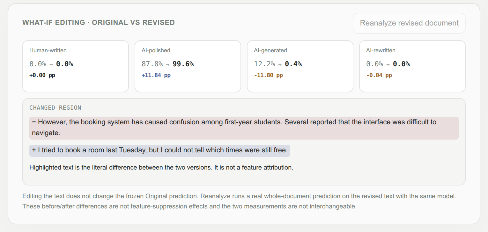
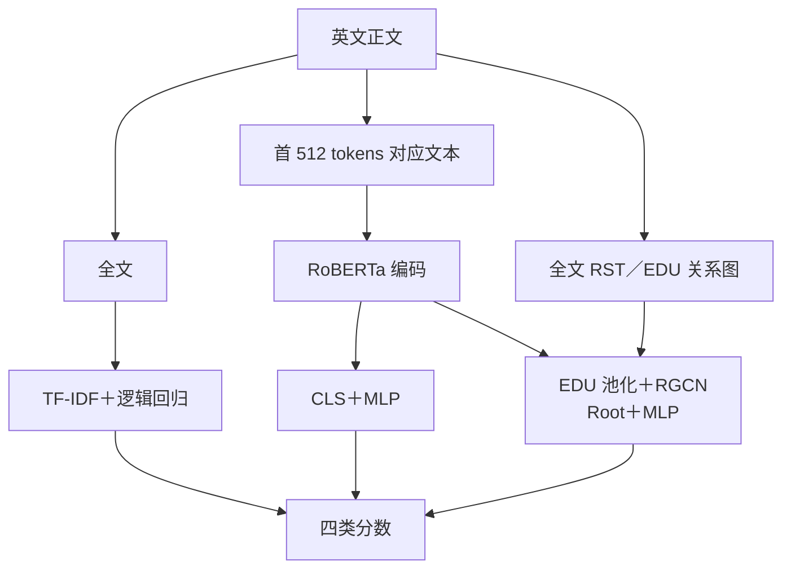
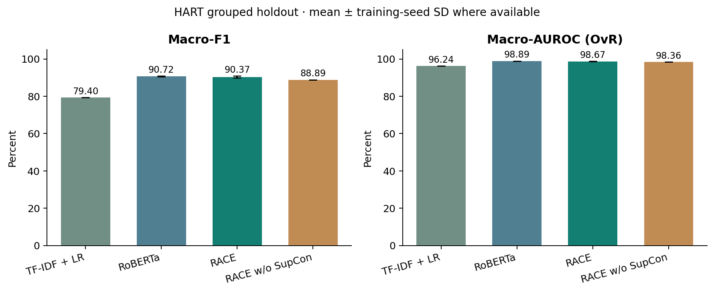
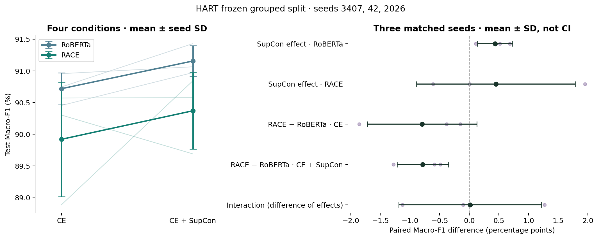

# EE6405 · 英文文本创作与编辑来源检测

[English](README.md) | **简体中文**

比较 **TF-IDF＋逻辑回归、RoBERTa、RACE**，并以 CE／CE＋SupCon 构成架构 × 损失的 2×2 消融，分析英文文本的创作与后续编辑来源。项目基于 [RACE](https://github.com/ICTMCG/RACE) 做课程复现与实验分析，新增固定分组划分、基线对照、多种子评估、解析审计和原始文本 Demo。

**实验状态（2026-11-06）：[2×2 消融](docs/ABLATION_2X2.md) 已全部完成。** 四种神经配置各三个种子，共 **12 次神经训练＋1 次 TF-IDF 基线**；新增五次训练、完整测试集重载复核、配对分析及图表均已完成。四方法 HC3 辅助评估和原始文本 Demo 已验证。课程提交材料与平台状态单独记录在 [提交准备](docs/SUBMISSION.md)。

## Text Lab 演示

Text Lab 是在本机运行的英文 Demo。粘贴英文文本后，选择 TF-IDF＋逻辑回归、RoBERTa、RACE 或无 SupCon 的 RACE，即可查看四类分数。

<p align="center">
  
</p>

*截图来自 RACE 模型载入后对内置无标签示例的实际预测。*

- 在 **Explore & Edit** 中，通过 **Map** 按段落跳转并查看解释进度，通过 **Passages** 对选定片段单独预测。**Coverage** 显示词汇输入范围。TF-IDF 读取全文，RoBERTa 和 RACE 的词汇输入最多为 512 个 token。
- 在 **Explain Prediction** 中，可以展开 RACE 篇章图的分支，对选定或可见的单元按需计算 **Influence**。详情面板显示抑制该单元特征后四类分数如何变化。同一文本和模型的后续解释请求可以复用预处理结果。
- 使用 **What-if editing** 修改原文，然后点击 **Reanalyze revised document**，用同一个模型重新预测。Text Lab 保留 **Original** 的结果，与 **Revised** 一起显示四类分数和文本改动。
- **Compare models** 对同一文本分别运行各模型。**Export** 可导出 JSON 报告，勾选后才会附上原文。

<details>
  <summary>查看修改示例后四类分数的对比</summary>
  <p align="center">
    
  </p>
</details>

[在本机运行 Text Lab](#在-linux-或-windows-wsl2-上运行-text-lab) · [单元影响的计算方法](docs/DOCUMENT_EXPLANATION.md)

## 任务与数据

| 标签 | 数据集中的操作定义 |
|---|---|
| `human_written` | 人工原文 |
| `human_ai_polished` | 人工内容经 AI 润色 |
| `ai_generated` | AI 内容，包括发布版本中的 AI 到 AI 改写链 |
| `ai_humanized` | AI 内容经人工或工具改写；不等于已确认真人编辑 |

主实验使用 **HART**：清理后 15,984 条，按同源文本及重复关联分组隔离，训练／验证／测试为 **11,190／1,600／3,194**。其 arxiv、essay、news、writing 是同一基准的四个子域。

独立辅助评估使用 **HC3** 的 1,000 条人类／ChatGPT 回答。HC3 只有二分类真值，不能用于验证创作者／编辑者四分类泛化。数据版本、获取位置和运行前提见 [数据与外部资源](data/README.md)。

### 实验流程



各模型独立训练；RoBERTa 与 RACE 使用相同基础初始化。HART 使用作者发布的 RST 树，Demo／HC3 使用本机解析器。两种神经架构分别启用或关闭 SupCon；损失开关不改变各自推理结构。

## 实验结果

使用固定 HART 分组测试集，神经模型只按验证集 Macro-F1 选 checkpoint。十二次神经运行均完成完整测试集重载复核，保留原确定性 TF-IDF 基线。



| 方法 | 训练次数 | Macro-F1 | Macro-AUROC |
|---|---:|---:|---:|
| TF-IDF + logistic regression | 1 | 79.40% | 96.24% |
| RoBERTa · CE | 3 | 90.72% ± 0.25 | 98.89% ± 0.02 |
| RoBERTa · CE + SupCon | 3 | 91.15% ± 0.24 | 98.90% ± 0.06 |
| RACE · CE | 3 | 89.92% ± 0.90 | 98.34% ± 0.11 |
| RACE · CE + SupCon | 3 | 90.37% ± 0.60 | 98.67% ± 0.11 |

四个神经配置各使用种子 3407、42、2026；报告均值 ± 样本标准差，标准差单位为百分点。

- 同种子配对后，SupCon 对 RoBERTa 的平均 Macro-F1 增益为 **+0.44 个百分点**，对 RACE 为 **+0.45 个百分点**。
- 相同目标下，RACE−RoBERTa 的差异为：**CE 下 -0.80**、**CE＋SupCon 下 -0.78 个百分点**。交互项（RACE 的损失增益 − RoBERTa 的损失增益）为 **+0.01 个百分点**。逐种子差值及其 SD 见完整报告。
- 架构差异仍包含 pooling、表示维度、参数量和全篇结构信息，不能全部归因于篇章图。
- 本轮五次补跑在查看原有结果后确定，沿用同一保留测试集；三个训练种子不构成新增独立测试，也不能证明广泛泛化。
- HC3 仍是原单种子辅助二分类比较：完整 RACE 的 Macro-F1 为 38.69%、AI 召回为 8.40%。本轮 2×2 补跑针对 HART，不能据此推出 HC3 上也有相同收益。



完整结果见 [实验报告](experiments/reports/comparison/REPORT.md)；运行与证据边界见 [2×2 消融协议](docs/ABLATION_2X2.md)。另有 [错误案例](experiments/reports/comparison/CASE_STUDIES.md)、[HC3 分析](experiments/reports/auxiliary/REPORT.md) 和 [方法说明](experiments/METHOD_NOTES.md)。

## 快速查看与运行

### 仅克隆仓库：复核保存结果

在仓库根目录执行，使用 Python 3 标准库，无需 GPU、数据集或模型权重：

```bash
python3 scripts/check_results.py
```

脚本从逐条预测重新计算指标，核对十三个正式运行、四组 HC3 结果、汇总表与五个配对消融差异。它检验保存结果的内部一致性；重新加载 checkpoint 推理仍需要外部资源。

### 在 Linux 或 Windows WSL2 上运行 Text Lab

```bash
# 先安装 Python 3.11、Git、GitHub CLI、C/C++ 编译器。
# 每位组员需要私有仓库读取权限，并执行 gh auth login。
export EE6405_STORAGE="$HOME/ee6405-resources"
python3 scripts/setup_environment.py --python python3.11 --torch cpu
export EE6405_PYTHON="$EE6405_STORAGE/.venv/bin/python"

"$EE6405_PYTHON" scripts/fetch_resources.py --profile demo
"$EE6405_PYTHON" scripts/check_installation.py --predict
bash experiments/run_demo.sh
```

服务启动后，打开 <http://127.0.0.1:8765/>。Text Lab 默认在 CPU 上运行。

私有 [resources-v1 Release](https://github.com/Realsbt/ee6405-nlp-project/releases/tag/resources-v1) 已提供 TF-IDF 分类器和全部 12 个神经模型权重。使用 `scripts/fetch_resources.py --profile full` 下载重跑测试推理所需的权重与数据。

Demo profile 下载约 **4.28 GiB** 资源，另加 Python 环境。上游资源从固定版本的原始来源获取。已经在迁移后的 Linux checkout 和新建独立 CPU 环境中跑通四个 Demo 模型，并完成固定数据重建和预处理检查。提供 WSL2 步骤，本次验证在 Linux 完成。

系统准备、完整数据恢复、硬件要求和 GPU 训练见 **[Linux / WSL2 复现指南](docs/REPRODUCING.zh-CN.md)**。原来的 `/data/botao/ee6405-race-validation/` 继续作为本机资源目录；组员自行设置 `EE6405_STORAGE`。历史结果中的路径在读取时映射，保留原始来源记录。

## 仓库内容

```text
README.md                 英文项目概况、结果、运行入口
README.zh-CN.md           中文项目概况
docs/                     课程原文、要求整理、提交清单
data/README.md            外部数据、权重与环境说明
experiments/              数据处理、训练、评估、RST 与 Demo
  configs/                冻结的实验配置
  reports/                正式指标、逐条预测、图表与审计记录
  METHOD_NOTES.md          实际模型与实验方法
  SOURCES.md               论文、代码、数据与版本来源
  VIDEO_OUTLINE.md         9 分 20 秒真人讲解提纲
scripts/check_results.py   无额外依赖的结果一致性复核
scripts/                  环境安装、资源下载与校验入口
resources/                固定资源清单和 HC3 原始选择记录
```

原始数据、模型权重、Python 环境、官方源码副本和一般运行日志不进入 Git。历史 smoke、旧版辅助输出和含正文的错误清单保留在原工作区，相关分析可在完整环境中重生成。提交的逐条预测保存 ID、标签和模型分数，不包含原始文章正文。视频成品及其可编辑工程保留在本地，不进入 Git，以保持仓库简洁。

## 提交前待完成

- 制作理论／结果 slides，按 [讲解提纲](experiments/VIDEO_OUTLINE.md) 录制不超过 10 分钟的真人视频。
- 整理小组反思、真实成员贡献及全员签名，填写课程正式 GAI declaration 模板。
- 按课程平台要求整理代码附件；确认模型资源的交接方式和实际演示环境。
- 每位成员完成个人互评，并由小组完成课程平台上传与回执核查。

以上事项的状态与验收方式见 [提交准备](docs/SUBMISSION.md)。课程原文和评分标准见 [课程要求](docs/course-requirements.md)，第三方来源与使用边界见 [SOURCES](experiments/SOURCES.md)。
