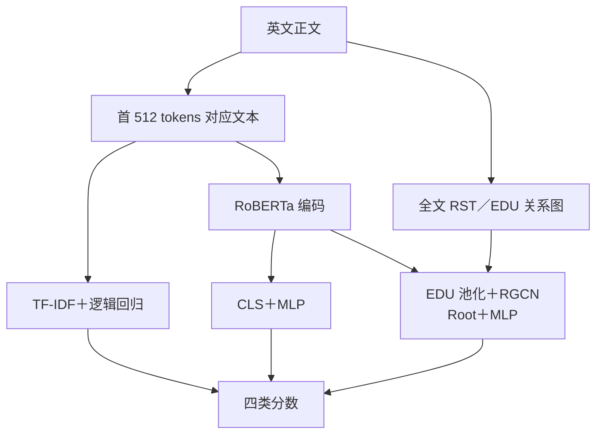

# EE6405 · 英文文本创作与编辑来源检测

[English](README.md) | **简体中文**

比较 **TF-IDF＋逻辑回归、RoBERTa、RACE**，并以 CE／CE＋SupCon 构成架构 × 损失的 2×2 消融，分析英文文本的创作与后续编辑来源。项目基于 [RACE](https://github.com/ICTMCG/RACE) 做课程复现与实验分析，新增固定分组划分、基线对照、多种子评估、解析审计和原始文本 Demo。

**实验状态（2026-11-06）：[2×2 消融](docs/ABLATION_2X2.md) 已全部完成。** 四种神经配置各三个种子，共 **12 次神经训练＋1 次 TF-IDF 基线**；新增五次训练、完整测试集重载复核、配对分析及图表均已完成。四方法 HC3 辅助评估和原始文本 Demo 已验证。课程提交材料与平台状态单独记录在 [提交准备](docs/SUBMISSION.md)。

## Yingqi 的新增贡献与运行状态

**快照时间：2026-11-12 13:22，新加坡时间（UTC+8）。** 以下是 `yingqi`
分支新增工作，与上面的组内共享 2×2 实验分开计算。详细归属、证据和复跑入口见
[个人贡献与状态报告](docs/YINGQI_STATUS.md)。

- **新增方法模块：RoBERTa + Text-EDU 残差门控融合。**
  保留全文 CLS 表示，加入注意力选出的 EDU 局部信息，再学习每篇文本应该加入多少：
  `CLS + gate(CLS, EDU_context) * EDU_context`。
  配套实现 CLS／均值／注意力／门控四组对照。这是本项目新增模块，
  不是宣称发明 RoBERTa、CLS、EDU、注意力或门控概念。
- **更公平的机制消融：** 固定相同首 512 tokens，比较正文、篇章图、
  关系打乱图、EDU 等权聚合；完成缓存、切分隔离、可见范围与解析偏移审计。
- **已有提升结果：Stacking 的 HART 测试 Macro-F1 为 93.61%。**
  用 CPU 训练小型逻辑回归，融合既有 RoBERTa CE、RACE SupCon 和 TF-IDF 的预测。
  这是实际跑出的单底层种子集成成绩，不是新门控模型的成绩，也不是三种子均值。
- **可靠性分析：** 外部迁移、低误报阈值和编辑敏感性分析；
  Stacking 在固定 MixSet 子集上的 Macro-F1 为 36.22%，未保留域内增益。

### 哪些跑过 GPU，哪些还没跑完

| 工作 | 已完成／使用算力 | 尚未完成 |
|---|---|---|
| 同窗口四条件 | Tesla T4 完成 seed 3407 的 4 次正式训练和全量测试预测 | seed 42、2026 的 8 次计划训练未完成 |
| CLS／均值／注意力／门控融合 | T4 完成 4 组 CUDA smoke、seed 3407 四组正式验证训练，以及 CLS seed 42 | 主线剩余 3 次确认训练和最终三种子测试报告 |
| 融合补跑任务 | Kaggle API 状态为 `RUNNING`；原任务为 `CANCEL_ACKNOWLEDGED` | 仍未跑完，尚无已核验的最终汇总 |
| 概率融合、Stacking、外部分析 | 复用此前 GPU 训练的神经模型；新增筛选、元模型训练与评估在 CPU 完成 | 不计作新增 GPU 编码器训练 |
| 固定／全局／自适应门控对照，切分＋一致性，校准和 DFS 调度 | 实现、CPU 检查、测试与云端入口已上传 | 正式 GPU 结果未完成，不宣称提升 |

这里是**四种条件，不是四个随机种子**：同窗口计划使用 3407／42／2026 三个种子。
融合主线采用“四组筛选＋匹配基线和入选模型补两个种子”，共 8 次正式训练。
补跑复用已完成 checkpoint；中断的部分训练不冒充完成。

### 已完成的同窗口结果

四组均为 seed 3407、CE、相同可见文本与基础预训练初始化；测试集 3,194 条。

| 条件 | 验证 Macro-F1 | 测试 Macro-F1 |
|---|---:|---:|
| 正文 `text` | 91.38% | **91.28%** |
| 篇章图 `graph` | 89.32% | 89.69% |
| 关系打乱 `shuffled` | 89.33% | 90.07% |
| EDU 等权聚合 `edu` | 90.91% | 90.89% |

这个种子下正文最好，原关系图未胜过打乱关系；不能由此推断所有种子或所有任务都如此。
[原始结果与逐条预测](experiments/reports/same_window/seed_3407/)已上传。

融合四组 seed 3407 的**验证集** Macro-F1 分别为 CLS **90.6435%**、
均值 **90.8501%**、注意力 **90.8956%**、门控 **91.3643%**。
门控比匹配 CLS 高 **0.7208 个百分点**，因此被选中继续确认；
这是用于选型的验证集差值，最终测试提升仍未确定。

训练和补跑代码见 [融合说明](docs/EDU_FUSION.md)，归属见
[复用与贡献说明](docs/REUSE_ATTRIBUTION.md)，未完成路线见
[后续协议](docs/FUSION_NEXT_STEPS.zh-CN.md)。实现使用 AI 辅助，仍需按课程要求填写声明。
共享数据划分、编码器、训练基础设施和原 RACE 组件不重复算作新模块贡献。
私有正文、权重和凭证不上传；上传的是代码、配置、指标、ID／标签／概率及哈希证据。

无需 GPU 或第三方 Python 库即可复核本次新增的保存结果：

```bash
python3 scripts/check_yingqi_results.py
```

## 任务与数据

| 标签 | 数据集中的操作定义 |
|---|---|
| `human_written` | 人工原文 |
| `human_ai_polished` | 人工内容经 AI 润色 |
| `ai_generated` | AI 内容，包括发布版本中的 AI 到 AI 改写链 |
| `ai_humanized` | AI 内容经人工或工具改写；不等于已确认真人编辑 |

主实验使用 **HART**：清理后 15,984 条，按同源文本及重复关联分组隔离，训练／验证／测试为 **11,190／1,600／3,194**。其 arxiv、essay、news、writing 是同一基准的四个子域。

独立辅助评估使用 **HC3** 的 1,000 条人类／ChatGPT 回答。HC3 只有二分类真值，不能用于验证创作者／编辑者四分类泛化。数据版本、获取位置和运行前提见 [数据与外部资源](data/README.md)。

### 方法概览



各模型独立训练；RoBERTa 与 RACE 使用相同基础初始化。HART 使用作者发布的 RST 树，Demo／HC3 使用本机解析器。两种神经架构分别启用或关闭 SupCon；损失开关不改变各自推理结构。

## 实验结果

使用固定 HART 分组测试集，神经模型只按验证集 Macro-F1 选 checkpoint。十二次神经运行均完成完整测试集重载复核，保留原确定性 TF-IDF 基线。


| 方法 | 训练次数 | Macro-F1 | Macro-AUROC |
|---|---:|---:|---:|
| TF-IDF + logistic regression | 1 | 79.40% | 96.24% |
| RoBERTa · CE | 3 | 90.72% ± 0.25 | 98.89% ± 0.02 |
| RoBERTa · CE + SupCon | 3 | 91.15% ± 0.24 | 98.90% ± 0.06 |
| RACE · CE | 3 | 89.92% ± 0.90 | 98.34% ± 0.11 |
| RACE · CE + SupCon | 3 | 90.37% ± 0.60 | 98.67% ± 0.11 |

四个神经配置各使用种子 3407、42、2026；报告均值 ± 样本标准差，标准差单位为百分点。

- 同种子配对后，SupCon 对 RoBERTa 的平均 Macro-F1 增益为 **+0.44 个百分点**，对 RACE 为 **+0.45 个百分点**。
- 相同目标下，RACE−RoBERTa 的差异为：**CE 下 -0.80**、**CE＋SupCon 下 -0.78 个百分点**。交互项（RACE 的损失增益 − RoBERTa 的损失增益）为 **+0.01 个百分点**。逐种子差值及其 SD 见完整报告。
- 架构差异仍包含 pooling、表示维度、参数量和全篇结构信息，不能全部归因于篇章图。
- 本轮五次补跑在查看原有结果后确定，沿用同一保留测试集；三个训练种子不构成新增独立测试，也不能证明广泛泛化。
- HC3 仍是原单种子辅助二分类比较：完整 RACE 的 Macro-F1 为 38.69%、AI 召回为 8.40%。本轮 2×2 补跑针对 HART，不能据此推出 HC3 上也有相同收益。


完整结果见 [实验报告](experiments/reports/comparison/REPORT.md)；运行与证据边界见 [2×2 消融协议](docs/ABLATION_2X2.md)。另有 [错误案例](experiments/reports/comparison/CASE_STUDIES.md)、[HC3 分析](experiments/reports/auxiliary/REPORT.md) 和 [方法说明](experiments/METHOD_NOTES.md)。

## 快速查看与运行

### 仅克隆仓库：复核保存结果

在仓库根目录执行，使用 Python 3 标准库，无需 GPU、数据集或模型权重：

```bash
python3 scripts/check_results.py
```

脚本从逐条预测重新计算指标，核对十三个正式运行、四组 HC3 结果、汇总表与五个配对消融差异。它检验保存结果的内部一致性；重新加载 checkpoint 推理仍需要外部资源。

### 在 Linux / Windows WSL2 运行英文 Demo

<p align="center">
  
</p>

*Demo 界面及演示材料使用英文。示例没有真实来源标签；图中耗时仅为该次请求记录，不是冷启动基准。*

```bash
# 先安装 Python 3.11、Git、GitHub CLI、C/C++ 编译器。
# 每位组员需要私有仓库读取权限，并执行 gh auth login。
export EE6405_STORAGE="$HOME/ee6405-resources"
python3 scripts/setup_environment.py --python python3.11 --torch cpu
export EE6405_PYTHON="$EE6405_STORAGE/.venv/bin/python"

"$EE6405_PYTHON" scripts/fetch_resources.py --profile demo
"$EE6405_PYTHON" scripts/check_installation.py --predict
bash experiments/run_demo.sh
```

Demo 地址为 <http://127.0.0.1:8765/>，默认 CPU。已有服务时直接打开地址。页面展示四类分数、输入截断、篇章树与耗时；无真实标签的自由输入仅用于功能演示。

GitHub 已保存全部 13 组正式结果；`resources-v1` 仍提供原始 8 个模型，未包含本轮新增 5 个 checkpoint。Demo 保留原四种方法，未新增 RoBERTa＋SupCon 选项。

Demo 需下载约 **4.28 GiB** 资源，另加 Python 环境。我们的 checkpoint 单独放在私有仓库的 [resources-v1 Release](https://github.com/Realsbt/ee6405-nlp-project/releases/tag/resources-v1)，上游资源从固定版本的原始来源获取，不进入 Git。已经在迁移后的 Linux checkout、新建独立 CPU 环境中跑通四个 Demo 模型，并完成固定数据重建和预处理检查；提供 WSL2 步骤，但本次没有实际测试 WSL2。

系统准备、完整数据恢复、硬件要求和 GPU 训练见 **[Linux / WSL2 复现指南](docs/REPRODUCING.zh-CN.md)**。原来的 `/data/botao/ee6405-race-validation/` 继续作为本机资源目录；组员自行设置 `EE6405_STORAGE`。历史结果中的路径在读取时映射，保留原始来源记录。

## 仓库内容

```text
README.md                 英文项目概况、结果、运行入口
README.zh-CN.md           中文项目概况
docs/                     课程原文、要求整理、提交清单
data/README.md            外部数据、权重与环境说明
experiments/              数据处理、训练、评估、RST 与 Demo
  configs/                冻结的实验配置
  reports/                正式指标、逐条预测、图表与审计记录
  METHOD_NOTES.md          实际模型与实验方法
  SOURCES.md               论文、代码、数据与版本来源
  VIDEO_OUTLINE.md         9 分 20 秒真人讲解提纲
scripts/check_results.py   无额外依赖的结果一致性复核
scripts/                  环境安装、资源下载与校验入口
resources/                固定资源清单和 HC3 原始选择记录
```

原始数据、模型权重、Python 环境、官方源码副本和一般运行日志不进入 Git。历史 smoke、旧版辅助输出和含正文的错误清单保留在原工作区，相关分析可在完整环境中重生成。提交的逐条预测保存 ID、标签和模型分数，不包含原始文章正文。视频成品及其可编辑工程保留在本地，不进入 Git，以保持仓库简洁。

## 提交前待完成

- 制作理论／结果 slides，按 [讲解提纲](experiments/VIDEO_OUTLINE.md) 录制不超过 10 分钟的真人视频。
- 整理小组反思、真实成员贡献及全员签名，填写课程正式 GAI declaration 模板。
- 按课程平台要求整理代码附件；确认模型资源的交接方式和实际演示环境。
- 每位成员完成个人互评，并由小组完成课程平台上传与回执核查。

以上事项的状态与验收方式见 [提交准备](docs/SUBMISSION.md)。课程原文和评分标准见 [课程要求](docs/course-requirements.md)，第三方来源与使用边界见 [SOURCES](experiments/SOURCES.md)。
