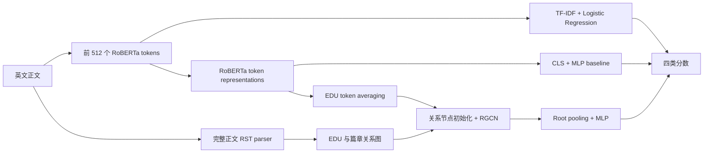

# EE6405 真人讲解提纲（目标 9 分 20 秒）

录制前先确认 `reports/comparison/summary.json` 的状态为 `completed`，并使用该版本的主表和图。这里安排的是讲解顺序，不替小组编造贡献或决定成员分工。可以由后续实际讲解者自然交接；不要使用合成配音。

| 时间 | 画面 | 讲解要点 |
|---|---|---|
| 0:00–0:45 | 标题、四类标签及一个创作/编辑过程示意 | 问题是最终文本如何同时反映创作和后续改写。目标是比较词汇、预训练语言表示和篇章图结构；这是复现与实验分析项目。 |
| 0:45–1:35 | HART 分组示意、样本分布 | 同一原文的衍生变体须留在一个分区。原发布划分存在来源组交叉，因此建立固定分组划分；清理后 15,984 条，训练/验证/测试 11,190/1,600/3,194。人工/工具改写 AI 是最少的一类，单看 Accuracy 容易忽略它。 |
| 1:35–2:40 | 三条模型流程图 | TF-IDF＋逻辑回归代表词汇模式；RoBERTa 用 CLS 表示；RACE 把文本分为 EDU，再用篇章关系图和 RGCN 形成 root 表示。复用官方模型，新增的是实验协议、对照、审计和可复现推理链路。 |
| 2:40–3:30 | 损失与消融图 | 总损失为交叉熵＋监督对比损失。后者在一个 batch 内拉近同类、区分异类。关闭对比损失而保留其他架构，检查该训练目标是否有帮助。 |
| 3:30–4:15 | 配置及 Python 关键位置 | 共用基础 RoBERTa、同一分组划分、相同平衡 batch 和早停规则；仅解冻最后一层。先 smoke，再训练、按验证集选 checkpoint、最后测试并重载复核。展示 `configs/neural_v1.json`、`train_neural.py` 的选模位置，不逐行念代码。 |
| 4:15–5:20 | `main_metrics.png`、`confusion_matrices.png` | 报告主模型三种子的均值与 SD，明确消融只有一个种子。解释 Macro-F1 与 AUROC 分别反映类别均衡的离散分类和排序表现。指出实际混淆最多的标签对及其样本量，不只读总体分数。 |
| 5:20–6:15 | 截断子集表、`domain_metrics.png`、一个错误案例 | RoBERTa/TF-IDF 使用首 512 tokens；RACE 还保留全篇关系节点。对照词汇窗口完整子集，讨论这一信息差异。域内切片不叫跨域迁移；错误例从完整错误清单中按清楚的规则选取。 |
| 6:15–7:10 | HC3 二分类辅助表 | 独立数据有 500 对人类/ChatGPT 回答，不能评价四分类编辑角色。固定分数 P(AI-generated)+P(AI-humanized)，阈值 0.5。解释实际退化和人工误报率，不在看到 HC3 后换阈值。HART 高分不能保证任意数据可靠。 |
| 7:10–8:35 | 实际操作 Demo | 输入示例、切换 RoBERTa/RACE、查看四类分数、真实 RST 树、截断状态和端到端耗时。说明示例无真实来源标签。展示已记录的真实冷启动成本，再演示缓存请求；若重新测量冷启动，应先重启服务，避免把预加载后的首个请求当成冷启动。 |
| 8:35–9:20 | 局限、结论、参考文献 | 用真实结果回答篇章结构与对比损失是否有帮助，说明三种子/一划分及单次消融的限制。下一步可以加入更多独立数据、匹配结构可用信息和更充分的消融。以引用的论文、官方仓库与数据来源结束。 |

## 可直接解释的模型图

RACE 在本实现中是一个四分类网络，不是两个独立的“创作者分类器”和“编辑者分类器”。四类标签是数据发布版本的操作定义；`ai_humanized` 包含人工或工具改写，不能把它说成已证明有真人编辑。

监督对比损失可以写为：对一个样本 i，将同标签的其他样本作为正例 P(i)，用其归一化表示的相似度与 batch 内所有非自身样本比较。温度 τ=0.07 控制分布尖锐程度。平衡 batch 16 提供每类 4 条，因此每个锚点都有正例。消融只移除这部分损失，交叉熵仍然保留。

## 展示代码的建议位置

- `prepare_data.py`：冲突标签排除、关联分组、固定划分，解释为什么先审计数据。
- `neural.py`：平衡采样、首 512 tokens、RoBERTa 的 pad ID=1。
- `train_neural.py`：损失组合、验证集选模、保存最佳 checkpoint、选定之后才打开测试集。
- `verify_neural.py`：重载 checkpoint，复算全部测试预测与指标。
- `rst_worker.py` / `rst_service.py`：原始英文到真实 RST 树；仅在 CPU parser 初始化时采用内存优化，不替换解析结果。
- `inference.py` / `demo_server.py`：真实 checkpoint 的本机推理与交互界面。

展示源码时保留对应文件名和少量相关行，避免在终端滚动大量训练输出。详细日志和逐条预测作为可检查附件。

## 根据结果回答，而不是预设成功

如果 RACE 没有稳定超过 RoBERTa，可以解释为：在当前数据与只解冻最后一层的预算下，增加结构并未带来可靠的总体收益；结合完整窗口子集、种子波动和错误类型说明原因候选。这仍是一项有效的模型比较。

如果 RACE 更高，先说明差值、种子波动和来源分组 bootstrap 的条件区间，再讨论可用结构信息与模型容量不同。不要直接把全部差值归因于图结构或宣称普遍泛化。

HC3 与 Demo 分别支持辅助二分类和可用性证据，不能补成四分类的独立泛化结果。详细数据、模型、代码来源见 [SOURCES.md](SOURCES.md)。

## 队长录制前应能独立说明

1. 逐一解释四个标签，尤其是少数类 `ai_humanized` 的操作定义。
2. 用一个原文及其改写说明为什么随机逐条划分会高估表现。
3. 说清 TF-IDF、CLS、EDU、篇章关系、root pooling 和对比损失各自在做什么。
4. 在配置文件中指出学习率、batch、解冻层数与选模标准，并解释为什么不能用测试集选择它们。
5. 找到一条错误记录，区分“观察到的错误”与“尚未验证的原因假设”。
6. 实际启动 Demo、切换模型，解释截断、冷启动与解析开销，并复跑一个保存模型的验证入口。

完成这些理解和复跑后，讲解才有足够依据。视频、真人讲解与课程平台提交由用户后续完成。
