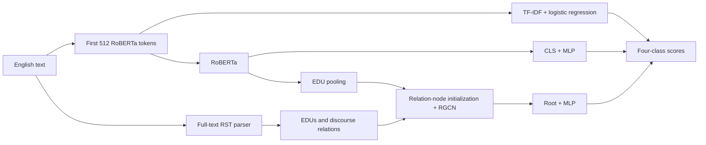

# EE6405 human presentation outline · target 9 minutes 20 seconds

Use English for the slides, interface, captions and spoken presentation. Before recording, confirm that `reports/comparison/summary.json` has status `completed` and use its current tables and figures. This outline proposes a sequence, not member contributions or speaker assignments. Assign sections according to the group's actual work. Use human narration; do not use synthetic voice.

| Time | Visual | Talking points |
|---|---|---|
| 0:00–0:45 | Title, four labels and a creation/editing diagram | Explain how a final text can reflect both creation and subsequent rewriting. Compare lexical patterns, pretrained language representations and discourse graphs. Identify this as a reproduction and experimental analysis project. |
| 0:45–1:35 | HART grouping diagram and sample distribution | Variants of one source text must stay in the same partition. Source groups overlap in the original split, so we construct a fixed grouped split. After cleaning: 15,984 records; train/validation/test: 11,190/1,600/3,194. The rewritten-AI class is the smallest, which makes accuracy alone insufficient. |
| 1:35–2:40 | Three model pipelines | TF-IDF + logistic regression captures lexical patterns. RoBERTa uses a CLS representation. RACE pools elementary discourse units (EDUs) and applies an RGCN over discourse relations to obtain a root representation. We reuse the official model and add the experimental protocol, comparisons, audits and reproducible inference workflow. |
| 2:40–3:30 | Loss and ablation diagram | Training combines cross-entropy and supervised contrastive loss. The latter brings same-label examples closer within a batch. Remove that loss while retaining the architecture to examine its contribution. |
| 3:30–4:15 | Configuration and selected Python excerpts | Use the same base RoBERTa, grouped split, balanced batches and early-stopping rule; unfreeze only the final encoder layer. Explain smoke checks, training, validation-only checkpoint selection, final testing and reload verification. Show `configs/neural_v1.json` and checkpoint selection in `train_neural.py`, without reading the code line by line. |
| 4:15–5:20 | `main_metrics.png` and `confusion_matrices.png` | Report three-seed means and sample SDs for the main neural models, with only one ablation seed. Explain class-balanced discrete performance (Macro-F1) and ranking performance (AUROC). Identify the observed confusion pairs and their sample counts. RACE does not outperform RoBERTa overall in these results. |
| 5:20–6:15 | Truncation subset table, `domain_metrics.png` and an error case | TF-IDF and RoBERTa use the first 512 tokens; RACE also retains full-document relation nodes. Use the fully covered subset to discuss this information difference. Within-benchmark domain slices are not cross-domain transfer. Select an error example using an explicit rule. |
| 6:15–7:10 | HC3 auxiliary binary results | HC3 contains 500 human/ChatGPT pairs and cannot evaluate the four editing-role classes. Use the fixed AI score, P(AI-generated) + P(AI-humanized), at threshold 0.5. Discuss degradation and human false positives without retuning the threshold on HC3. High HART scores do not establish reliability on arbitrary text. |
| 7:10–8:35 | Actual demo operation | Enter the example, compare RoBERTa and RACE, then inspect the scores, parsed RST tree, truncation status and end-to-end time. State that the example is unlabeled. Distinguish recorded cold-start costs from requests using loaded models. Restart the service before measuring a new cold start. A locally prepared 75-second silent English screenshot walkthrough is available for rehearsal; label it as a replay if used. |
| 8:35–9:20 | Limitations, conclusion and references | Answer whether discourse structure and contrastive loss helped using the actual results. Explain the limits of three seeds, one split and one ablation run. Possible follow-up work includes more independent data, matched information coverage and broader ablations. End with the cited paper, official repository and data sources. |

## Model diagram

This implementation of RACE is one four-class network, not two independent creator and editor classifiers. Labels follow the dataset's operational definitions. `ai_humanized` includes rewriting by people or tools and does not establish that a human editor was involved.

For supervised contrastive learning, the other examples with the same label form the positive set P(i) for anchor i. Compare similarities between normalized representations against all non-self examples in the batch. Temperature τ = 0.07 controls the distribution. Balanced batches of 16 contain four examples per class, providing positives for each anchor. The ablation removes only this loss term; cross-entropy remains.

## Useful code excerpts

- `prepare_data.py`: conflicting-label exclusion, linked groups and the fixed split; explain why the data audit comes first.
- `neural.py`: balanced sampling, the first 512 tokens and RoBERTa's padding ID of 1.
- `train_neural.py`: combined loss, validation selection and saving the best checkpoint before final test evaluation.
- `verify_neural.py`: checkpoint reload and recomputation of all test predictions and metrics.
- `rst_worker.py` / `rst_service.py`: raw English text to an actual RST tree; CPU initialization uses a memory optimization without substituting parse results.
- `inference.py` / `demo_server.py`: local inference with verified checkpoints and the interactive interface.

Show the filename and a few relevant lines. Keep detailed logs and individual predictions available as inspectable evidence rather than scrolling through them in the video.

## Interpret the observed results

RACE's mean Macro-F1 is 90.37%, compared with RoBERTa's 90.72%. Under this data protocol and final-layer-only training budget, the added structure does not provide a reliable overall gain. Discuss possible explanations alongside the fully covered subset, seed variability and error patterns; distinguish hypotheses from measured effects.

The seed-3407 no-SupCon comparison suggests a benefit of 1.95 percentage points, but the ablation has only one run. Differences in structural information and model capacity also prevent attributing all model differences to discourse structure alone.

HC3 supports an auxiliary binary evaluation; the demo shows functionality. Neither provides independent validation of four-class generalization. See [SOURCES.md](SOURCES.md) for data, model and code provenance.

## Presenter preparation

Before recording, each presenter should be able to explain their section and the group should be able to:

1. Define each label, especially the minority `ai_humanized` class.
2. Use a source text and a rewrite to explain why a random record-level split can inflate performance.
3. Explain TF-IDF, CLS, EDUs, discourse relations, root pooling and contrastive loss.
4. Locate the learning rate, batch size, unfrozen layers and selection criterion, and explain why test data must not choose them.
5. Trace one error record and distinguish the observed error from an untested causal hypothesis.
6. Launch the demo, switch models, explain truncation, cold start and parsing costs, and rerun a saved-model verification entry point.

Final human narration, signatures and course-platform submission remain the group's responsibility.
