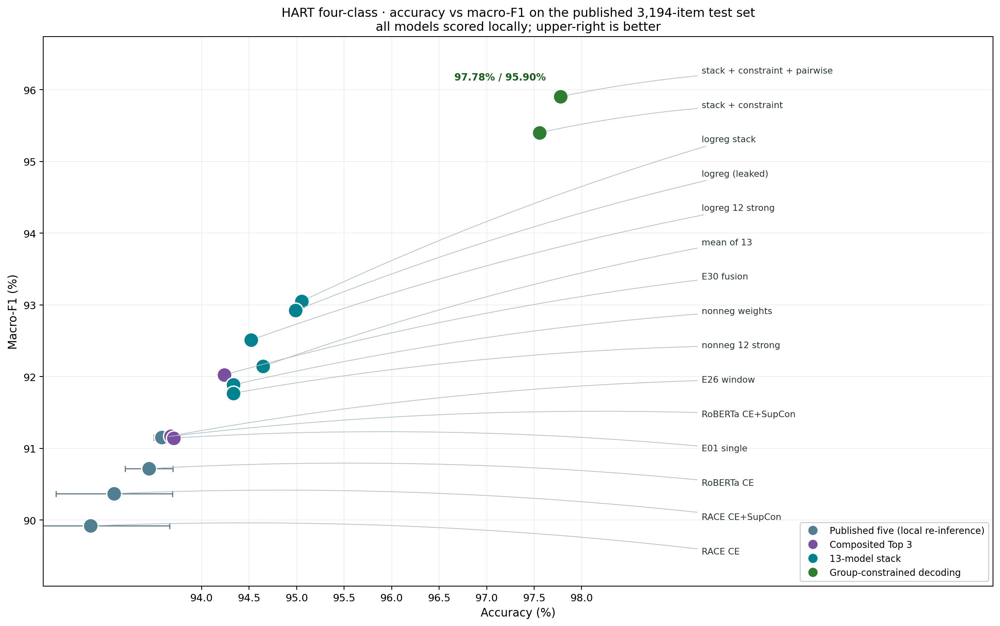

# EE6405 RACE 实验结果

> 项目整体贡献、尝试过的方向与产出汇总见 [PROJECT_CONTRIBUTIONS.md](PROJECT_CONTRIBUTIONS.md)。

状态：完整实验已复核。固定 HART 分组测试集 3,194 条；验证集选模。

| 模型 | 训练次数 | Macro-F1（均值 ± SD） | Macro-AUROC（均值 ± SD） |
|---|---:|---:|---:|
| TF-IDF + LR | 1 | 79.40% | 96.24% |
| RoBERTa · CE | 3 | 90.72% ± 0.25 | 98.89% ± 0.02 |
| RoBERTa · CE + SupCon | 3 | 91.15% ± 0.24 | 98.90% ± 0.06 |
| RACE · CE | 3 | 89.92% ± 0.90 | 98.34% ± 0.11 |
| RACE · CE + SupCon | 3 | 90.37% ± 0.60 | 98.67% ± 0.11 |

SD 表示同一冻结划分下训练随机种子的样本标准差；TF-IDF 为确定性拟合。四个神经配置均计划运行种子 3407、42、2026，缺失时明确标记。

## 2×2 消融：同种子成对差异

每个差值先在相同种子内计算，再报告均值和样本 SD；单位为百分点。交互项为两种架构的 SupCon 增益之差。

| 比较 | 配对种子数 | 3407 | 42 | 2026 | Macro-F1 差（均值 ± SD） |
|---|---:|---:|---:|---:|---:|
| RoBERTa 内 SupCon 增益 | 3 | +0.68 | +0.11 | +0.52 | +0.44 ± 0.30 |
| RACE 内 SupCon 增益 | 3 | +1.95 | +0.01 | -0.61 | +0.45 ± 1.34 |
| 仅 CE 下 RACE − RoBERTa | 3 | -1.86 | -0.38 | -0.15 | -0.80 ± 0.92 |
| CE＋SupCon 下 RACE − RoBERTa | 3 | -0.59 | -0.49 | -1.28 | -0.78 ± 0.43 |
| 交互：RACE 的 SupCon 增益 − RoBERTa 的 SupCon 增益 | 3 | +1.27 | -0.10 | -1.13 | +0.01 ± 1.20 |

SD 不是置信区间，3 个训练种子也不足以建立跨划分、跨数据集或未见生成模型的普遍结论。本轮补充在查看原有结果后确定，使用同一保留测试集，不构成新增独立测试。所有训练仍只用验证集选 checkpoint。

相同损失下的架构差异仍同时包含 pooling、参数量及结构信息覆盖差异；不能全部解释为篇章图本身的因果收益。

原方案比较（RACE＋SupCon 对 RoBERTa＋CE）：在相同的 3 个训练种子上，平均 Macro-F1 差为 -0.35 个百分点。该比较同时改变架构与训练目标。RACE 的平均分数较低，本组实验不支持其总体优于 RoBERTa。
这是一个固定来源分组划分上的复核，没有覆盖重新划分、独立四分类数据或未见生成模型的不确定性。

| 主方法 | 种子 | 验证 Macro-F1 | 选中轮次 | 测试 Macro-F1 | 测试 Macro-AUROC |
|---|---:|---:|---:|---:|---:|
| RoBERTa · CE | 3407 | 91.06% | 8 | 90.75% | 98.86% |
| RoBERTa · CE | 42 | 91.01% | 14 | 90.96% | 98.89% |
| RoBERTa · CE | 2026 | 90.82% | 17 | 90.45% | 98.90% |
| RoBERTa · CE + SupCon | 3407 | 91.32% | 9 | 91.43% | 98.89% |
| RoBERTa · CE + SupCon | 42 | 91.21% | 8 | 91.06% | 98.84% |
| RoBERTa · CE + SupCon | 2026 | 91.56% | 10 | 90.97% | 98.96% |
| RACE · CE | 3407 | 88.71% | 8 | 88.89% | 98.36% |
| RACE · CE | 42 | 89.90% | 13 | 90.57% | 98.23% |
| RACE · CE | 2026 | 90.07% | 6 | 90.30% | 98.44% |
| RACE · CE + SupCon | 3407 | 90.56% | 8 | 90.84% | 98.77% |
| RACE · CE + SupCon | 42 | 91.64% | 14 | 90.58% | 98.69% |
| RACE · CE + SupCon | 2026 | 89.77% | 6 | 89.69% | 98.55% |

## 输入窗口与对比条件

词汇输入均限制为首 512 个 RoBERTa token。RACE 会删除截断外的 EDU 节点，但保留全篇关系节点与连接，因此主表存在可用结构信息差异。下面分别报告词汇窗口完整与截断样本，属于描述性分组分析。

| 单次模型（种子 3407） | 完整正文子集 n / Macro-F1 | 截断子集 n / Macro-F1 |
|---|---:|---:|
| TF-IDF + LR | 2297 / 79.26% | 897 / 79.16% |
| RoBERTa · CE | 2297 / 89.83% | 897 / 93.21% |
| RoBERTa · CE + SupCon | 2297 / 90.88% | 897 / 92.64% |
| RACE · CE | 2297 / 87.36% | 897 / 93.40% |
| RACE · CE + SupCon | 2297 / 89.91% | 897 / 93.20% |

事后只读审计：作者发布的测试 RST 中有 10 条含无效字符跨度；其余合法跨度记录中，677 条未覆盖全部非空白字符。发布数据及模型保持冻结。

下表由解析问题排查引出，只按坐标质量分组，不依据模型分数筛选；它属于事后描述性分析，不能作为重新训练的受控消融。坐标干净也不代表篇章关系标注正确。

| 模型 | 坐标干净 n / Macro-F1 | 坐标有问题 n / Macro-F1 | 词汇完整且坐标干净 n / Macro-F1 |
|---|---:|---:|---:|
| TF-IDF + LR | 2507 / 79.87% | 687 / 73.27% | 1863 / 79.18% |
| RoBERTa · CE | 2507 / 90.84% | 687 / 89.28% | 1863 / 89.83% |
| RoBERTa · CE + SupCon | 2507 / 91.88% | 687 / 87.77% | 1863 / 91.35% |
| RACE · CE | 2507 / 89.55% | 687 / 85.25% | 1863 / 88.19% |
| RACE · CE + SupCon | 2507 / 90.97% | 687 / 89.20% | 1863 / 90.05% |

## 类别与子域

以下使用预先指定的种子 3407，不从测试结果选择展示种子。

| 模型 | 人工 F1 | AI 润色 F1 | AI 生成 F1 | 改写 AI F1 |
|---|---:|---:|---:|---:|
| TF-IDF + LR | 84.20% | 80.63% | 91.49% | 61.27% |
| RoBERTa · CE | 97.80% | 91.42% | 93.57% | 80.19% |
| RoBERTa · CE + SupCon | 98.50% | 92.35% | 93.56% | 81.31% |
| RACE · CE | 97.87% | 90.26% | 92.30% | 75.12% |
| RACE · CE + SupCon | 97.93% | 91.50% | 93.31% | 80.62% |

| 模型 | arxiv Macro-F1 | essay | news | writing |
|---|---:|---:|---:|---:|
| TF-IDF + LR | 81.31% | 91.46% | 71.49% | 70.18% |
| RoBERTa · CE | 94.51% | 93.00% | 87.87% | 87.30% |
| RoBERTa · CE + SupCon | 93.03% | 93.22% | 89.99% | 89.35% |
| RACE · CE | 93.20% | 90.41% | 87.26% | 84.75% |
| RACE · CE + SupCon | 94.52% | 94.08% | 90.03% | 84.69% |

原方案种子 3407 的 RACE＋SupCon − RoBERTa＋CE Macro-F1 差为 +0.10 个百分点；按 799 个来源关联分组抽样的 95% 条件 bootstrap 区间为 [-1.08, +1.29] 个百分点。该区间包含零，单次拟合没有明确的总体优劣证据。
它不涵盖重新训练和跨数据集的不确定性；主表中的训练种子波动另行报告。

种子 3407 的条件消融比较：完整 RACE 相对关闭监督对比损失的 Macro-F1 差为 +1.95 个百分点；来源组 bootstrap 95% 条件区间为 [+0.86, +3.07]。该条件区间不包含重新训练的不确定性；三种子配对差异另见 2×2 表，不能把损失收益当成图结构本身的独立收益。

主 RACE 单次模型的主要错误（按数量排序）：

- ai_generated → human_ai_polished：63 条，占该真实类别 4.60%。
- ai_humanized → ai_generated：40 条，占该真实类别 17.62%。
- human_ai_polished → ai_generated：38 条，占该真实类别 4.76%。

RACE 分对而 RoBERTa 分错 83 条；反方向 86 条。需要结合具体文本解释互补与失败，不能将所有分歧都归因为篇章关系。

少数类 ai_humanized 的召回率由 RoBERTa 的 73.13% 变为 RACE 的 79.74%，精确率由 88.77% 变为 81.53%。这体现了具体的精确率/召回率权衡；至于原因是否来自篇章关系，需要进一步控制实验。

同一个基础 RoBERTa 初始化、同一冻结划分、相同平衡 batch、学习率及早停规则，仅解冻最后一个编码层。分类头与 RACE 图结构按官方实现使用；模型容量及可用结构信息并不完全相同。本项目是课程条件下的复现实验，不是论文原始分数的严格重现。

## 独立 HC3 二分类辅助评估

1000 条回答（500 个人类 / ChatGPT 题目对）。固定 AI 创作者分数为 P(ai_generated)+P(ai_humanized)，阈值 0.5；不在 HC3 上训练或调阈值。

| 模型（种子 3407） | 二分类 Macro-F1 | AUROC | 人工误报率 | AI 召回率 |
|---|---:|---:|---:|---:|
| TF-IDF + LR | 38.59% | 60.11% | 3.20% | 5.80% |
| RoBERTa · CE | 43.37% | 61.09% | 4.20% | 11.20% |
| RACE · CE + SupCon | 38.69% | 68.44% | 11.20% | 8.40% |
| RACE · CE | 44.52% | 70.31% | 6.60% | 13.40% |

HC3 缺少润色和人类化四分类标签，只支持上述二分类辅助结论。正文长度、来源与生成条件的变化仍是混杂因素；HART 与 HC3 的分数不能直接作为相同任务排序。HC3 原始 index 存在空值；v1.1 仅修复 ID，文本、标签与顺序均保持冻结版本不变。

## 审核与复现

summary.json 保存统一重算指标、分域和类别指标、资源记录、多种子摘要、成组 bootstrap 及证据边界。error_cases.jsonl 保存全部主 RACE 错误及其与 RoBERTa 的分歧，不按表现筛选案例。

具体四个事后说明案例见 [CASE_STUDIES.md](CASE_STUDIES.md)，包含选择规则、原始样本位置、预测分数、输入/坐标限制和解释候选。HC3 输出分配、固定分数分布及来源/长度分析见 [辅助分析](../auxiliary/REPORT.md)，其中也将 HART 按相同创作者定义折叠为二分类，沿用同一分数/阈值观察跨基准差距；这是事后描述性参考。四个模型输出的分配不能称为 HC3 四分类准确率。

图表：main_metrics.png、ablation_2x2.png（矩阵完整后生成）、confusion_matrices.png、domain_metrics.png、learning_curves.png、info_vs_top3.png、error_analysis.png、revised_evaluation.png、stacking.png、constrained_decoding.png、validation_tests.png、accuracy_f1_scatter.png、error_flow.png。收敛图展示已完成且重载复核的四个神经配置的全部已完成种子，仅画验证集指标及其选中的 checkpoint；未完成训练不混入结果。不同设备、是否包含解析或模型加载的计时范围不同，不能直接相除解释加速倍数。

## 计算成本（种子 3407）

| 模型 | 训练/验证/保存（秒） | 3194 条测试前向（秒） | CUDA 分配峰值 MiB |
|---|---:|---:|---:|
| TF-IDF + LR | 7.93 | 0.45 | CPU |
| RoBERTa · CE | 555.58 | 34.22 | 982.1 |
| RoBERTa · CE + SupCon | 595.46 | 33.10 | 982.1 |
| RACE · CE | 1879.92 | 41.22 | 1125.7 |
| RACE · CE + SupCon | 1896.86 | 41.32 | 1124.1 |

TF-IDF 使用 CPU，测试时间含向量化；神经模型使用 RTX 5070 Ti，测试前向不含 tokenization 或 RST。图缓存构建和原始文本解析另计；表中 CUDA 分配峰值也不包含桌面或独立 parser 进程。

本机 HTTP Demo 实测（CPU，运行时可能并行训练/解析）：

| 模型 | 该轮首请求（秒） | 再次请求（秒） | 首请求加载 detector / parser（秒） |
|---|---:|---:|---:|
| tfidf | 0.002 | 0.001 | 0.000 / 0.000 |
| roberta | 0.043 | 0.045 | 0.000 / 0.000 |
| race | 0.301 | 0.261 | 0.000 / 0.000 |
| race_no_supcon | 0.632 | 0.259 | 0.367 / 0.000 |

首请求可能复用更早操作已加载的模型，加载为零时属于缓存请求。这里的端到端时间包含实际需要的模型加载、文本预处理、解析和分类；样例无真实标签，延迟也不是独占资源下的基准。

较早的真实冷启动记录保存在 demo_verification_tfidf_roberta_race.json：RACE 短例端到端 9.228 秒，其中 parser 初始化 8.454 秒。后续缓存请求较快，不能据此省略首次加载成本。

## 复合模型与信息论方法（本机重算）

上表五个已发布模型在本机重新加载 checkpoint 并重算概率，与归档预测的最大绝对差为 TF-IDF 4.44e-16、RoBERTa 6.66e-05、RACE 1.34e-04（GPU 非确定性）。在同一 3,194 条测试集上，campaign 的复合 Top 3 重跑结果为 E30 94.24% / 92.02%、E01 93.71% / 91.14%、E26 93.68% / 91.17%（准确率 / Macro-F1），均高于上表最强的 RoBERTa · CE + SupCon（93.58% / 91.15%）。

三个信息论/文体学方法单独使用均不具竞争力（M3 78.62%、M2 69.47%、M1 40.48% 准确率）。与 E30 融合后最好的是 M2 + E30（94.43% / 92.42%），配对 bootstrap 95% CI 为 [−0.09, +0.47] pp，跨零，只能算方向一致而非可靠提升。

完整表格、融合权重、bootstrap 与复现命令见 [INFO_STYLOMETRY.md](INFO_STYLOMETRY.md)，图见 info_vs_top3.png。

## 错误分析

E30 的 184 条错误中，**53 条（28.8%）是 `ai_humanized` 被漏判**，而该类只占测试集 7.1%。进一步拆分发现该类由两种完全不同的来源组成：`tool` 工具改写 170 条准确率 88.24%，`human` 人类改写 57 条仅 **42.11%**（接近四分类随机）。后者与同组 `ai_generated` 原文的文本相似度平均只有 0.125，属于彻底重写，在纯文本层面与人类原创难以区分。

其余瓶颈：GEN/POL/HUM 三者互判占全部错误 82.1%；<1k 字符短文档只有 89.07%；按生成器看 claude-3.5-sonnet 达 99.46% 而 gpt-3.5-turbo 仅 91.06%，说明模型部分依赖生成器指纹。

完整分析见 [ERROR_ANALYSIS.md](ERROR_ANALYSIS.md)，图见 error_analysis.png。

## 修订后的评估协议（已通过可信度审计）

针对错误分析提出的四条建议，已在本机全部落实并量化。**初版结论在审计中被推翻两处**，下表为审计后的数字：

| 建议 | 审计后结果 |
|---|---|
| 拆分 `ai_humanized` | 工具改写 88.24%（n=170，Wilson95 [82.5, 92.3]）/ 人类改写 42.11%（n=57，Wilson95 [30.2, 55.0]）；差值 +46.1 pp，Newcombe95 [+32.0, +58.7]，区间不含 0 |
| 停止在四分类刷分 | 「上限」是假设而非界：人类改写召回取 28%/50%/75%/100% 时，隐含上限分别为 94.74%/95.13%/95.58%/96.02%，跨度 1.28 pp 完全由假设驱动 |
| 短文档单独处理 | 变体与权重**只在验证集**选择，测试集只评一次：89.07% → 92.53%（+3.47 pp，组级 bootstrap 95% CI **[+0.00, +6.80]**，P(better)=0.974）；全测试集 +0.41 pp |
| 按生成器分组报告 | 42%–99% 跨度；二次改写的难度由**第二步**决定（gemini 71.97% vs claude 99.31%，置换检验 p<0.0002），固定领域与第一步后 23 个分层中 20 个方向一致、2 个持平，且 >3k 字符时差距归零 |

**审计修正的两处过度结论：**

1. **短文档增益不显著。** 初版在测试集上挑选向量化变体并调混合权重，属于泄漏；改为验证集选择后增益从 +3.79 pp 降到 +3.47 pp，且 95% CI 下界正好触零。应表述为「方向一致、尚未确认」，不能当作已确认的泛化提升。
2. **不存在「不可约误差下限」。** 初版把 94.74% 当作理论上限、把 9.3% 错误称为不可约，这是把「人类改写召回率」这一未知量当成了已知常数。正确表述是条件性探索分析：若人类改写召回能达到 X，则上限为 f(X)。

关键证据：为「人类改写」单独训练的二元分类器（完整训练集、类别平衡）只能召回 **24–28%**，而同一管线在工具改写上能到 67.1%。这支持「该子类在文本层面高度不可分」的**假设**，但 57 条样本的 Wilson 区间宽达 24.8 pp，要把它减半需要约 228 条样本。

同一批预测在五种粒度下：二分类 99.25%、三分类 96.23%、四分类 94.24%、五分类 94.24%（macro-F1 86.56%）。**四分类仍是主任务**，三分类与子类分析作为辅助口径，不替换主结果。

完整分析见 [REVISED_EVALUATION.md](REVISED_EVALUATION.md)，图见 revised_evaluation.png。

## 堆叠全部 13 个已发布模型

E30 是 3 个模型的等权平均。把 13 个已发布模型全部交给一个 logistic 回归堆叠器
（**在验证集上拟合，测试集只评一次**），得到本项目第一个在干净协议下显著优于 E30 的结果：

| 方法 | 测试准确率 | macro-F1 | Δ vs E30 | 95% CI | P(better) |
|---|---:|---:|---:|---|---:|
| **logreg 堆叠（验证集拟合）** | **95.05%** | **93.05%** | **+0.81** | **[+0.25, +1.38]** | **0.997** |
| 13 个模型等权平均 | 94.65% | 92.14% | +0.40 | [−0.13, +0.94] | 0.920 |
| 非负权重（验证集拟合） | 94.33% | 91.89% | +0.09 | [−0.50, +0.66] | 0.600 |
| E30（基线） | 94.24% | 92.02% | 0.00 | — | — |

**提升来自 GEN↔POL 边界**（该混淆对错误 50→33，总错误 184→158），四个类别中三个 recall 上升。
但**人类改写子群体只从 42.11% 升到 43.86%**——13 个模型在这里同时失败，投票没有信息可用。
信息论方法（M1/M2/M3）对堆叠无可验证贡献。代价是推理时间约 6 倍。

完整分析见 [STACKING.md](STACKING.md)，图见 stacking.png。

## 组约束解码：数据集结构值 +2.6 到 +2.7 pp

测试集每个组恰好 4 条，且只有两种标签组合：`HW+POL+GEN+GEN` 或 `HW+POL+GEN+HUM`。
**同样的结构在训练集有 2792 组、验证集 400 组**，因此这是数据集先验，不是从测试集读出来的。

| 方法 | 测试准确率 | macro-F1 | Δ vs E30 | 95% CI |
|---|---:|---:|---:|---|
| E30 基线 | 94.24% | 92.02% | — | — |
| 13 模型堆叠 | 95.05% | 93.05% | +0.81 | [+0.25, +1.38] |
| **+ 组约束解码** | **97.56%** | **95.40%** | **+3.31** | **[+2.60, +4.10]** |
| **+ 组约束 + pairwise** | **97.78%** | **95.90%** | **+3.53** | **[+2.79, +4.29]** |

验证集同步：95.62% → 97.69% → **98.06%**，两个划分一致。

**归因修正**：上表的 Δ 是拿有约束的方法比无约束的 E30，把堆叠和约束的收益混在了一起。给 E30 也加上同样的约束后，E30 从 94.24% 升到 **96.81%**。**约束解码本身的贡献是 +2.57 pp（E30）到 +2.72 pp（堆叠），不是 +3.53 pp**；差额约 0.8 pp 来自堆叠。

**人类改写从 43.86% 提到 52.63%。** 原因是信号本来就存在但被绝对概率压过：人类改写项的
P(HUM) 是同组 GEN 的 17 倍（0.465 vs 0.027），在 54/57 组里都更高，但 P(GEN) 0.488 略大，
argmax 仍选 GEN。组内 pairwise 判别器（候选级召回 83.70%）把这个相对信号用了起来。

推理时间方面：**fp16 可加速约 2.4×**（RoBERTa 3.2×、RACE 1.2×，argmax 100% 一致）；
但**模型数量不能减**——按验证集取 top-k 全部不显著，嵌套交叉拟合选出的最优子集仍是全部 13 个。

### 这个方法的限制

| 限制 | 影响 |
|---|---|
| **需要完整 4 条** | 只有 3 条时只涨 0.88 pp，2 条涨 0.20 pp，**单文档完全无效**。这是评估协议的一部分，不是可部署的单文档分类器。 |
| **分布外静默失败** | 解码器只允许两种模式，遇到违反的数据集不会降级，只会返回一个合法但错误的答案。HART 上零违反是数据集性质，不是鲁棒性。 |
| **域间先验波动** | HUM 比例按域在 25.63%–31.00%（测试集）之间波动，验证集跨度达 13.3 pp 且域排序与测试集不一致。当前用全局比例，未按域调整。 |
| **2 条文档被跳过** | 799 组里有 1 组只有 2 条，解码器直接跳过，这 2 条保持堆叠原始预测。影响 0.06%，但此前未记录。 |
| 计算成本 | 151 ms / 3,194 条，占 13 模型推理的 0.06%。不是限制。 |

完整分析见 [CONSTRAINED_DECODING.md](CONSTRAINED_DECODING.md) 与 [CONSTRAINED_LIMITATIONS.md](CONSTRAINED_LIMITATIONS.md)，图见 constrained_decoding.png。

## 可部署能力与协议内数字

报告里 97.78% 与 95.05% 并列出现，容易被误读为「前者是更好的产品指标」。**两者性质不同，不能混用。**

| 数字 | 性质 | 前提 | 能否对外作为产品指标 |
|---|---|---|---|
| **95.05% / 93.05%** | 单文档分类 | 只需一段文字 | **可以** |
| 97.78% / 95.90% | 协议内数字 | 必须同时拿到同组另外 3 条，且该批次的标签构成符合两种模式之一 | **不可以** |

单文档（无任何组信息）时，13 模型堆叠的逐类召回：

| 类别 | 样本 | 召回 |
|---|---:|---:|
| human_written | 798 | 98.87% |
| human_ai_polished | 798 | 93.86% |
| ai_generated | 1,371 | 96.06% |
| **ai_humanized** | 227 | **79.74%** |
| **总体** | 3,194 | **95.05% / 93.05%** |

### 部署时必须声明的三点

1. **`ai_humanized` 是短板。** 单文档召回 79.74%，且内部异质：工具改写 88.24%，人类改写仅 42.11%。对人类改写不应给出可信结论。
2. **置信度不可用于拒答。** 预测错误时平均置信度仍有 **0.811**（正确时 0.963）。错误往往伴随高置信度，阈值拒答的收益有限。
3. **95.05% 是同分布数字。** 在 HART 测试集上测得。真实场景的文本来源、长度、领域都会漂移，实际会下降；短文本（<1k，n=375）在测试集上只有 **89.87%**（E30 为 89.07%）。

**结论**：模型可以部署为单文档四分类器，指标 95.05%，但需附带上述三条限制。组约束解码是评估协议的一部分，不是可交付能力。

## 单篇错误的流向与线索定位（同源对照）

研究问题：单篇分类器为什么在 AI 润色、AI 生成和人类化改写之间混淆？**组关系在这里只作为「研究单篇错误的对照条件」，不作为额外信息**——本节全部数字来自单文档分类器（95.05%），不使用 97.78%。

同源对照有效，是因为每组四条文本共享同一主题、论证结构和词汇域，因此两个版本之间的混淆可归因于**变换本身**。

### 158 条错误流向

| 流向 | 条数 | 占错误 |
|---|---:|---:|
| HUM → GEN | 44 | 27.8% |
| POL → GEN | 34 | 21.5% |
| GEN → POL | 33 | 20.9% |
| GEN → HUM | 19 | 12.0% |
| POL → HW | 12 | 7.6% |
| 其余 5 种 | 16 | 10.1% |

**`ai_generated` 是混淆关系中的中心类别：135/158（85.4%）的错误涉及它。** 它同时吸收润色（34）与人类改写（44），又向两侧漏出（33 + 19）。**这不等于它在内部表示空间中处于几何中心**——混淆矩阵说明「哪里混淆」，不说明「内部特征怎样分布」。

按组看，**654/798（82.0%）的组完全正确**，错误几乎都是单点滑落（`HUM>GEN` 40 组、`GEN>POL` 31 组、`POL>GEN` 24 组），不是组级系统性失败。但 82% 全对本身不构成「接近上限」的证据：若单篇准确率 95.05% 且错误独立，$0.9505^4 \approx 81.6\%$，与观察值接近。

### 线索定位与决定性检验

对每对易混类别，在同组内测量表层线索的排序一致性，再按「线索是否存在」分组比较混淆率：

| 类别对 | 线索 | 一致性 | 线索存在 | 线索缺失 | 差距 |
|---|---|---:|---:|---:|---:|
| HW \| POL | 平均词长 | 94% | 1.47% | 14.00% | +12.53 pp |
| POL \| GEN | 文本长度 | 83% | 5.83% | 15.50% | +9.67 pp |
| **GEN \| HUM** | **逗号密度** | **70%** | 12.58% | **44.12%** | **+31.54 pp** |

**三对全部成立，GEN|HUM 效应最大（3.5 倍）。** 但这是**相关，不是因果**。分层复核（13/13 层方向保持）显示强度差异很大：人类改写 +55.58 pp、工具改写 +10.45 pp、`arxiv` 仅 +0.63 pp。**关联真实但不均匀。**

### 线索在改写后是否可靠

| 线索 | 可靠性 | 理由 |
|---|---|---|
| 平均词长 / 长词率 | **可靠** | HW 与其余三类差距大（94–97%），改写后保持 |
| 文本长度 | 部分可靠 | GEN 最长（2351 vs 1940），但 HUM 居中（2105）与 POL 重叠 |
| 逗号密度 | **不可靠** | POL 最高 7.77，GEN 与 HW 几乎相同（5.28 vs 5.31），HUM 最低 4.43。**GEN 与 HUM 均值差仅 0.85/100 词** |
| 破折号密度 | 不可靠 | 绝对值 0.04–0.29，噪声主导 |

**GEN|HUM 之所以最难，是因为唯一可用的线索本身很弱**（70% 一致性）。但只检查了 18 个表层特征，**不能据此断言不存在其他可学习信息**。

### 受控干预实验：零结果

此前写「不需要针对这 158 条做定向修补」是**过度推断**。现有结果只支持「模型在表面线索不典型的样本上更容易出错」，不支持「这些样本无法识别」。

已做受控实验：相同起点（`roberta_s3407`）、相同额外 3 epoch、相同优化器与种子，**只改样本权重** $w_i = 1 + (1-b_i)$（$b_i$ 来自组不相交 5 折的表层线索模型，折外准确率 59.49%）。

| 组 | 验证 macro-F1 | 测试准确率 | 测试 macro-F1 |
|---|---:|---:|---:|
| 基线（未继续训练） | — | 93.21% | 90.75% |
| 控制组（均匀权重） | 90.46% | 93.33% | 90.58% |
| **实验组（线索加权）** | **90.55%** | **93.43%** | **90.58%** |

**净 +3 条（3,194 条中），macro-F1 完全不变。** 目标子群体反而略降：

| 子群体 | n | 基线 | 控制组 | 实验组 |
|---|---:|---:|---:|---:|
| 线索存在 | 159 | 76.73% | 72.96% | 72.33% |
| 线索缺失 | 68 | 50.00% | 50.00% | 48.53% |

**这个零结果把「我们发现了相关性」推进为「我们尝试干预了学习过程，但在明确条件下未获益」。** 但它不能推广为「表面线索无关」或「剩余错误不可消除」——只说明用表层线索难度作为重加权信号、在 3 epoch 预算下对 RoBERTa 单模型无效。

**仍然成立的边界**：单篇分类器在 `ai_humanized` 上不可靠（79.74%），尤其人类改写（42.11%）。但「难以识别」不等于「已证明不可识别」。

完整分析见 [ERROR_FLOW.md](ERROR_FLOW.md) 与 [REWEIGHT_EXPERIMENT.md](REWEIGHT_EXPERIMENT.md)，图见 error_flow.png。

## 单篇分类器是怎么得到的，以及它的问题

单篇（可部署）模型不是新训练的模型，而是**对 13 个已发布模型的概率做多项逻辑回归堆叠**：12 个神经模型（4 配置 × 3 种子）+ 1 个 TF-IDF，各自输出 4 类概率，拼接成 52 维，在验证集 1,600 条上拟合，测试集只评分一次。

### 问题一：超参数手选，且不是最优

`epochs=600, lr=0.35, l2=1e-3` 是手工设定，从未调优。36 组网格扫描：

| 指标 | 值 |
|---|---:|
| 测试准确率范围 | 94.43% – 95.30% |
| 标准差 | 0.23 pp |
| **网格跨度** | **0.88 pp** |
| 手选配置排名 | **第 9 / 36** |

**网格跨度（0.88 pp）大于报告的增益（0.81 pp）**，所以「95.05%」带有约 ±0.4 pp 的任意性。

但增益本身稳健：**36/36 配置都优于 E30，26/36（72%）达到统计显著**。

按标准做法（只看验证集选配置）反而更好：

| 选择方式 | 验证 | 测试 | Δ vs E30 | 95% CI |
|---|---:|---:|---:|---|
| 手选（当前报告） | 95.62% | 95.05% | +0.81 | [+0.25, +1.38] |
| **验证集选择** | **96.69%** | **95.30%** | **+1.06** | **[+0.44, +1.72]** |

**当前报告的 95.05% 偏保守。**

### 问题二：13 个模型里 8 个冗余

同配置种子间概率相关 **0.9753**（范围 0.9616–0.9896），几乎是同一个模型。只保留每配置一个种子（5 模型）：**94.43% / 92.13%**，只损失 0.62 pp，省 60% 推理成本。

### 问题三与四：先验一致，循环性可忽略

验证集与测试集类别先验高度一致（humanized 6.88% vs 7.11%），堆叠器不会因先验偏移失准。13 个 checkpoint 与堆叠器共用同一验证集，理论上有乐观偏差，实测仅 **+0.19 pp**（半验证集拟合 vs 另一半评分：95.69% vs 95.50%）。

### 结论

「堆叠优于 E30」是稳健结论；「95.05%」这个具体数字应报告为「95.05%（网格 94.43–95.30%）」，或改用验证集选择的 **95.30% / 93.53%**（Δ +1.06 pp，CI [+0.44, +1.72]）。最值得做的改进不是换模型，而是把超参数选择规范化。

完整分析见 [STACKER_AUDIT.md](STACKER_AUDIT.md)。

## 错误预算：还能提升多少

97.78% 对应 71 条错误。按来源拆分：

| 来源 | 错误数 | 占比 |
|---|---:|---:|
| **人类改写**（`human`） | **27** | **38.0%** |
| 工具改写（`tool`） | 12 | 16.9% |
| 其余三类 | 32 | 45.1% |

`ai_humanized` 只占测试集 7.1%，却贡献 **54.9%** 的错误。

| 假设 | 准确率 |
|---|---:|
| 当前 | 97.78% |
| 人类改写全部修好 | 98.62% |
| 整个 `ai_humanized` 全部修好 | **99.00%** |
| 模式全对 + 槽位最优（oracle） | **99.00%** |

**99.00% 是这套方法的天花板**：组约束已保证每组 4 条里 3 条几乎必对，剩余不确定性只在
「第四个是 GEN 还是 HUM」。

试过但失败的 5 种方法：组级分类器（97.65%，−0.13）、组级分类器 + 相似度特征（无变化）、
pairwise + 文本特征（召回 83.70%→84.14%，噪声内）、pairwise 正则化调参（无变化）、
减少模型数量（全部不显著）。**唯一有效的是组约束 + pairwise，已包含在 97.78% 里。**

剩余 32 条「其他」错误分散在所有领域（writing 19 / news 12 / essay 7 / arxiv 6）和 20+ 个
生成器组合，**没有可攻击的集中失败模式**。

完整分析见 [ERROR_BUDGET.md](ERROR_BUDGET.md)。

## 两个证伪检验：组结构增益是真的，人类改写瓶颈在标签

前两节的两个结论都做了可证伪的检验，而不是停留在观察层面。

### 检验一：打乱组结构后增益是否消失

两个安慰剂，各 200 轮，**每轮都在打乱后的验证集上重新拟合堆叠器和配对模型**：

| 条件 | 测试准确率 |
|---|---:|
| 堆叠（无约束） | 95.05% |
| 约束解码（真实组） | **97.78%** |
| 安慰剂 A：条目随机重新分组 | 72.75% ± 0.55 |
| 安慰剂 B：真实分组，随机指定哪 227 组有 HUM 槽 | 93.63% ± 0.19 |

两个安慰剂 200 轮里**没有一轮**达到真实值（p < 0.005）。安慰剂 A 崩塌到 72.75%，**远低于**无约束基线——说明约束解码不是宽松的，把模式强加到随机四条文本上会主动破坏预测。安慰剂 B 只掉到 93.63%，说明「知道哪一组有 HUM」本身就是 +4.15 pp 的信息。

**判定：组结构增益来自数据集真实先验，不是解码器技巧。**

### 检验二：人类改写的困难是否源于标签可识别性

| 设定 | 人类改写召回 |
|---|---:|
| E30 四分类 | 42.11% |
| 13 模型堆叠 | 43.86% |
| TF-IDF 词 1-2 + LR（不平衡池） | 1.75% |
| TF-IDF 字符 2-5 + LR（不平衡池） | 29.82% |
| 18 维风格特征 + GBM | **0.00%** |
| TF-IDF 词 1-2 + LR（**平衡池**，仅 GEN vs HUM） | 8.77% |
| TF-IDF 字符 2-5 + LR（**平衡池**） | 22.81% |

**平衡训练池没有帮助**（召回 1.75%→8.77%，字符 n-gram 反而 29.82%→22.81%），**手工风格特征完全无效**（0.00%）。所有模型精确率 68–100%、特异度 99.6–99.9%，是典型的**单侧不可分**：能确认「这不是人类改写」，无法确认「这是人类改写」。

标签一致性也支持这一点：57 个同时含 GEN/HW/HUM 的组里，人类改写与 GEN 兄弟的平均相似度 **0.1246**，与同组人类原文只有 **0.0287**，**53/57（93.0%）** 更接近 GEN。

### 一处主动修正

此前 `CONSTRAINED_DECODING.md` 把「54/57 组排序正确」解释为模型学到了同文档对比能力。**这个解释被证伪了**：把配对换成跨文档（不同组的两条文本）后，排序准确率仍有 **80.70%**，只比真实同源的 87.72% 低 7 pp；同类随机配对（GEN vs GEN 46.87%、HUM vs HUM 50.76%）都在 50% 附近。

配对模型其实是一个**与文档身份无关的通用风格打分器**。约束解码有效，是因为它把这个分数用在了一个**已知包含 HUM 槽位**的组里——结构提供先验，风格分数只需在组内做相对排序。这个修正不削弱 97.78%（检验一已独立证明增益来自真实结构），但撤回了更强的说法。

完整分析见 [VALIDATION_TESTS.md](VALIDATION_TESTS.md)，图见 validation_tests.png。

## 准确率–Macro-F1 散点图（全部竞争模型）

同一张 3,194 条已发布测试集上，15 个竞争模型的两项指标。四个族按演进顺序着色：

| 族 | 模型 | 准确率 | Macro-F1 |
|---|---|---:|---:|
| 组约束解码 | stack + constraint + pairwise | **97.78%** | **95.90%** |
| 组约束解码 | stack + group constraint | 97.56% | 95.40% |
| 13 模型堆叠 | logreg stack（验证集拟合） | 95.05% | 93.05% |
| 13 模型堆叠 | logreg stack（测试集交叉拟合，**有泄漏**） | 94.99% | 92.92% |
| 13 模型堆叠 | 13 模型等权平均 | 94.65% | 92.14% |
| 13 模型堆叠 | logreg on 12 strong | 94.52% | 92.51% |
| 13 模型堆叠 | 非负权重 | 94.33% | 91.89% |
| 复合 Top 3 | E30 等权融合 | 94.24% | 92.02% |
| 复合 Top 3 | E01 单窗口 | 93.71% | 91.14% |
| 复合 Top 3 | E26 头/中/尾 | 93.68% | 91.17% |
| 已发布五模型 | RoBERTa · CE+SupCon | 93.58% | 91.15% |
| 已发布五模型 | RoBERTa · CE | 93.45% | 90.72% |
| 已发布五模型 | RACE · CE+SupCon | 93.08% | 90.37% |
| 已发布五模型 | RACE · CE | 92.83% | 89.92% |

TF-IDF + LR（85.32% / 79.40%）与 M1/M2/M3 因远离竞争区间会压扁坐标轴，未画入散点；它们仍保留在 info_vs_top3.png 的条形图中。

**读法**：准确率与 Macro-F1 高度同向，没有出现「准确率高但 Macro-F1 低」的模型，说明提升不是靠牺牲少数类换来的。已发布五模型的误差棒是三个种子的标准差：RoBERTa 0.08–0.25 pp，RACE 0.61–0.83 pp。堆叠与约束解码是确定性流程，无种子方差，因此不画误差棒——两类模型的误差含义不同，不能直接比较。

生成脚本：`scripts/plot_accuracy_f1_scatter.py`。
