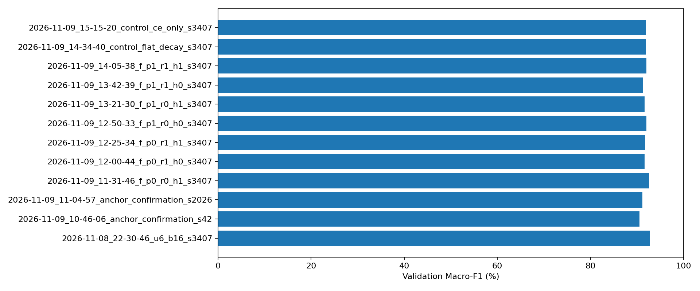
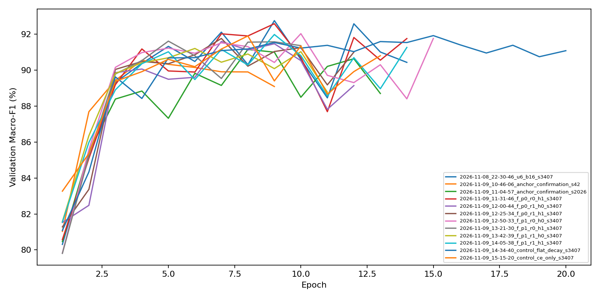
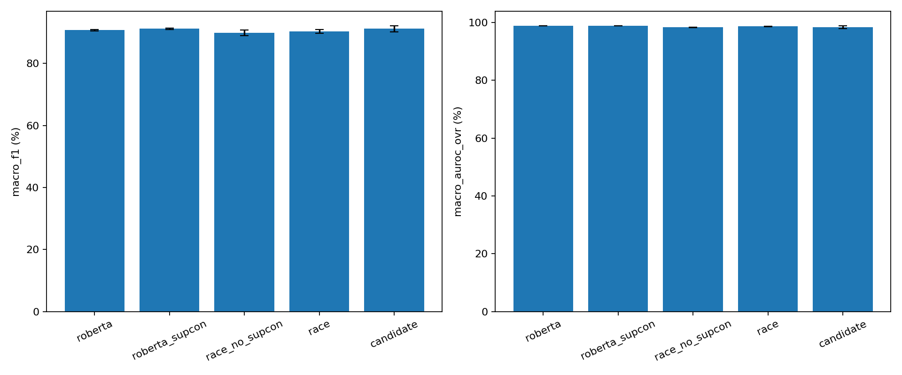
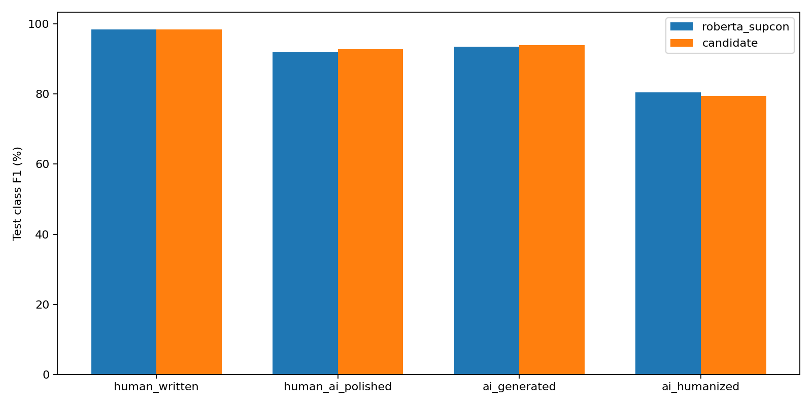
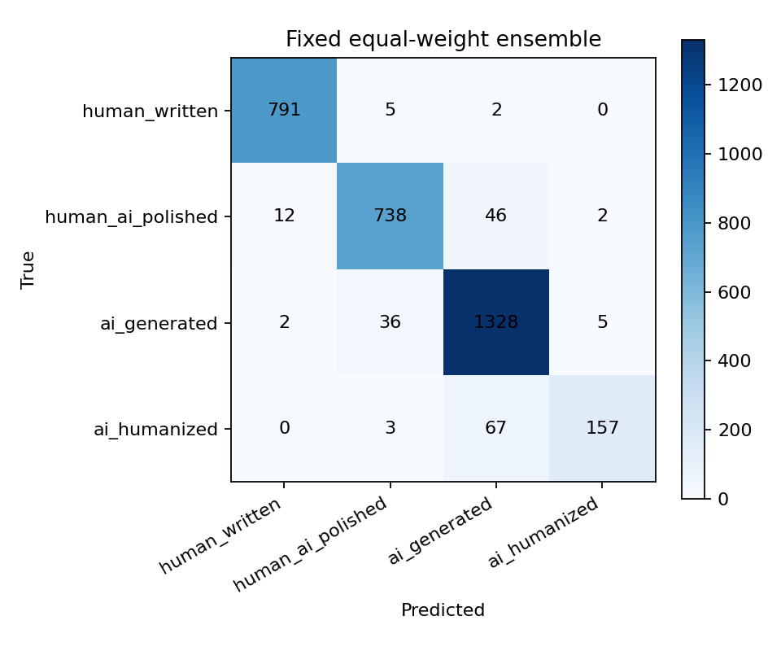

# A4000 research batch report

Historical results pinned to `877f12bb5b83a4825780f654309ecd9959f74f5a`.
Selection uses validation only. Repeated fixed test, not an independent new test.

| Run | Validation F1 | ai_humanized F1 | Train+val seconds | Peak MiB |
| --- | ---: | ---: | ---: | ---: |
| 2026-11-08_22-30-46_u6_b16_s3407 | 92.7596% | 82.5871% | 1712.8 | 2641.5 |
| 2026-11-09_10-46-06_anchor_confirmation_s42 | 90.5528% | 77.4869% | 1066.1 | 2641.5 |
| 2026-11-09_11-04-57_anchor_confirmation_s2026 | 91.1575% | 78.4530% | 1541.3 | 2641.5 |
| 2026-11-09_11-31-46_f_p0_r0_h1_s3407 | 92.5888% | 82.4121% | 1671.0 | 2641.5 |
| 2026-11-09_12-00-44_f_p0_r1_h0_s3407 | 91.6020% | 78.7565% | 1424.6 | 2641.5 |
| 2026-11-09_12-25-34_f_p0_r1_h1_s3407 | 91.7684% | 79.3814% | 1432.8 | 2641.5 |
| 2026-11-09_12-50-33_f_p1_r0_h0_s3407 | 92.0351% | 80.8511% | 1790.0 | 2644.1 |
| 2026-11-09_13-21-30_f_p1_r0_h1_s3407 | 91.6190% | 80.0000% | 1198.7 | 2644.2 |
| 2026-11-09_13-42-39_f_p1_r1_h0_s3407 | 91.2115% | 79.5918% | 1313.5 | 2644.1 |
| 2026-11-09_14-05-38_f_p1_r1_h1_s3407 | 91.9875% | 81.9149% | 1675.5 | 2644.2 |
| 2026-11-09_14-34-40_control_flat_decay_s3407 | 91.9261% | 79.1444% | 2372.0 | 2641.5 |
| 2026-11-09_15-15-20_control_ce_only_s3407 | 91.9075% | 78.7234% | 1529.0 | 2641.5 |

| Test method | Macro-F1 mean ± sample SD | Macro-AUROC |
| --- | ---: | ---: |
| roberta | 90.7184% ± 0.2518% | 98.8857% |
| roberta_supcon | 91.1544% ± 0.2418% | 98.8978% |
| race_no_supcon | 89.9206% ± 0.9037% | 98.3430% |
| race | 90.3699% ± 0.6028% | 98.6701% |
| candidate | 91.1558% ± 1.0423% | 98.4233% |

Paired seed F1 differences (percentage points): [0.9060842728779606, -0.2864955065684516, -0.6152586208066912].
Hardware/runtime also differ from historical runs; these differences do not isolate architecture effects.

Equal-weight ensemble test Macro-F1: 91.6999%.

## Figures

