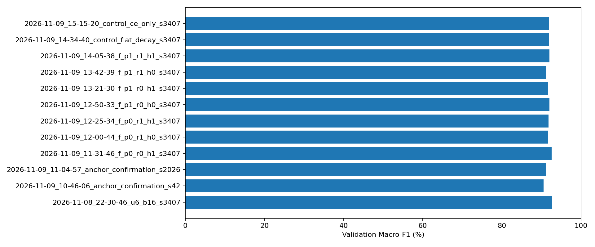
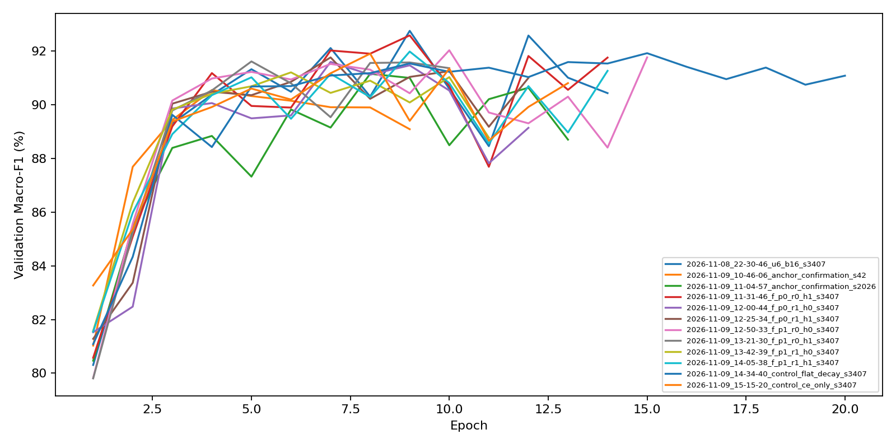
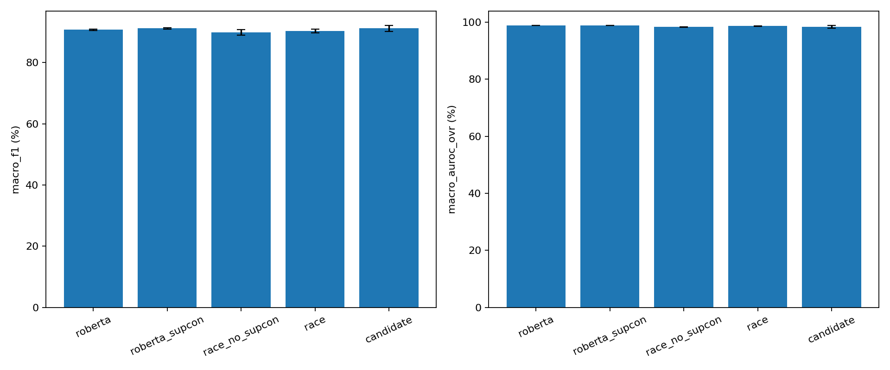
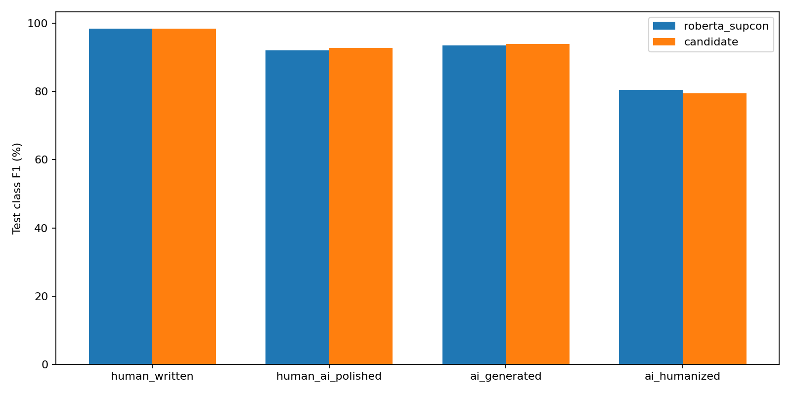
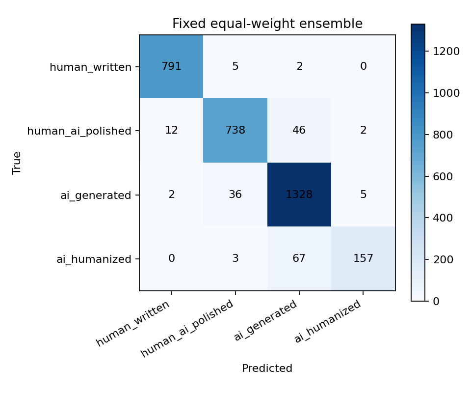

# 详细报告与可视化阅读指南

# 本批次简报

- 方法：解冻6层；顶层LR=1.5e-05，层间衰减=0.85；SupCon=True，投影头=False；内容/后处理辅助权重=0.0/0.0；真实batch=16，累积=1。
- 最终三种子test Macro-F1：91.1558% ± 1.042个百分点（样本SD）；原仓库三种子为91.1544%；上涨 0.001个百分点。
- 相对本机原版seed3407的训练吞吐：0.54倍；同3194条test的平均单模型FP32推理吞吐：1.11倍。
- 三模型集成需要三次前向，不能用单模型速度当作集成速度。
- 以validation选定配置后才运行test；未按test分数回头改配置。跨历史环境差异仍存在，不能将全部差异归因于方法本身。
- 条件推送门槛：最终三种子test Macro-F1均值高于原仓库三种子均值即推送；小幅增益不等于统计显著。
- [详细数字报告](REPORT.md) · [中文指标与图解](详细报告与图解.md) · [过程及错误](PROCESS_LOG.md)。

## 四个标签是什么

`human_written`：人工原文；`human_ai_polished`：人工内容经AI润色；`ai_generated`：AI内容；`ai_humanized`：AI内容经人或工具改写。

## 分数该怎么看

- Accuracy：全部文本中分对的比例，容易被数量多的类别主导。
- Precision：被模型判为某类的文本中，有多少真属于该类。Recall：真正属于某类的文本，有多少被找出来。
- F1综合precision与recall；Macro-F1把四类F1同等平均，因此少数类ai_humanized也同样重要。本项目主要比较这个指标。
- Macro-AUROC衡量把每类正例排在负例前面的能力；接近1通常更好，但不是“准确率”。
- TPR@1%FPR：误报率不超过1%时找出的正例比例；这是本评估集上的描述性分析，不是经过独立校准的上线阈值。
- 均值±SD：三个随机种子的平均和波动，不是置信区间。0.30个百分点是91.15%到91.45%，不是乘1.003。

## 每张图表达什么

### 1. 验证集配置比较

横向条越长表示该配置在validation的Macro-F1越高。所有筛选只用这张图对应的验证指标，不参考最终test。

### 2. 学习曲线

横轴是遍历训练数据的轮数epoch，纵轴是validation Macro-F1。升高说明模型在改善；训练更多却不升可能已收敛或过拟合。每条线是不同实验，不要只挑某轮尖峰去声称稳定提升。

### 3. 与原始仓库的测试结果比较

原版读取固定Git提交 `877f12bb5b83a4825780f654309ecd9959f74f5a`；candidate是本批次选中的配置。柱高是三个种子的平均，误差棒是样本SD。Macro-F1和AUROC是不同指标，不能直接把两种柱高当同一分数。

### 4. 逐类别F1比较

每组是一个类别。重点看ai_humanized是否改善，以及是否牺牲其他类别。整体涨分不等于每类都涨。

### 5. 混淆矩阵

行是真实类别，列是模型预测。对角线代表分对，其他格代表错分。比如ai_humanized这一行、ai_generated这一列的数字，就是“改写AI文本被误判为直接AI生成”的数量。不同类样本数不同，不宜只按颜色深浅比较难度。此图是预先固定的等权集成结果。

## 本批次详细测试指标

| Seed | Accuracy | Macro-F1 | AUROC | TPR@1%FPR |
| --- | ---: | ---: | ---: | ---: |
| 3407 | 94.6149% | 92.3345% | 98.4377% | 84.1721% |
| 42 | 93.6130% | 90.7771% | 98.8708% | 85.0525% |
| 2026 | 93.4878% | 90.3559% | 97.9615% | 71.1167% |

| 类别 | Precision均值 | Recall均值 | F1均值 |
| --- | ---: | ---: | ---: |
| human_written | 98.0119% | 98.8304% | 98.4192% |
| human_ai_polished | 93.3366% | 92.3141% | 92.8122% |
| ai_generated | 91.9349% | 96.1099% | 93.9678% |
| ai_humanized | 94.1378% | 68.8693% | 79.4241% |

## 适用边界

使用同一固定test的持续改进，不能叫全新独立测试。速度基线来自相同A4000，历史分数基线来自原仓库，二者分工不同。完整配置、哈希、逐条预测见批次文件，失败记录见PROCESS_LOG.md和logs/。

本轮以现有6层方案为主要参照：三种子平均Macro-F1变化 +0.0000 个百分点，Macro-AUROC变化 +0.0000 个百分点。是否回退原方案：True。自动推送还要求超过6层参照且AUROC下降不超过0.1个百分点；不是只超过最初仓库就推送。
